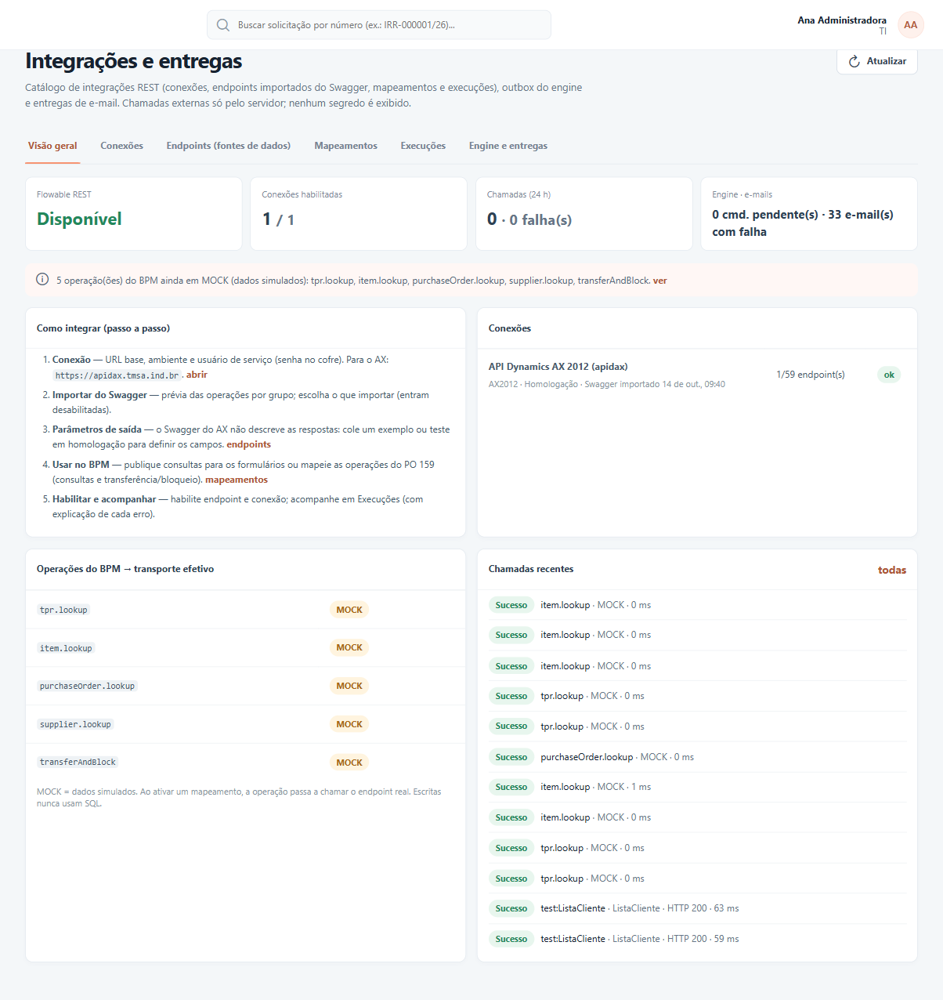

# Integrações — visão geral

As integrações permitem que o BPM **busque e grave informações em outros sistemas da empresa**, como o
Dynamics AX, sem que ninguém precise copiar dados à mão. Por exemplo:

- ao digitar um código num formulário, o BPM traz automaticamente o nome do cliente ou do fornecedor;
- quando um processo chega a determinada etapa, o BPM registra a operação no AX sozinho.

Tudo é configurado em **Administração → Integrações e entregas**.

## Palavras que aparecem nas telas

| Na tela | O que significa |
|---|---|
| **Conexão** | O "endereço" de um sistema externo (por exemplo, o AX) e a forma de entrar nele (usuário e senha do sistema). Cadastrada uma vez. |
| **Endpoint (fonte de dados)** | Um serviço específico desse sistema, como "consultar fornecedor por CNPJ" ou "criar ordem de transferência". Uma conexão tem vários. |
| **Swagger** | O catálogo de serviços que o próprio sistema externo publica. O BPM lê esse catálogo para cadastrar os endpoints para você. |
| **Consulta** | Um endpoint de leitura liberado para os formulários: o usuário digita um valor e clica em **Consultar**. |
| **Mapeamento (vínculo)** | A ligação entre uma operação do BPM e um endpoint real, dizendo qual informação vai para qual campo. Além das operações prontas, você pode criar **mapeamentos novos**: consultas para os formulários ou etapas automáticas para os fluxos. |
| **MOCK** | Modo de simulação: o BPM responde com dados fictícios, sem acessar nenhum sistema. É o padrão até a integração real ser ligada. |
| **Execuções** | O histórico de cada chamada feita a um sistema externo, com o resultado. |

## Por onde começar

| Você é… | Comece por | Depois |
|---|---|---|
| Responsável por configurar integrações | [Criar uma integração](guia-criar-integracao.md) | [Mapeamentos e modo simulado](guia-mapeamentos-e-mock.md) |
| Quem monta formulários | [Usar consultas nos formulários](guia-consumir-formulario.md) | [Criar uma integração](guia-criar-integracao.md) |
| Quem desenha fluxos | [Etapa do tipo Integração](guia-etapa-integracao.md) | [Mapeamentos e modo simulado](guia-mapeamentos-e-mock.md) |
| Suporte e acompanhamento | [Acompanhar e resolver problemas](guia-operacao-e-suporte.md) | [Etapa do tipo Integração](guia-etapa-integracao.md) |

## Resumo do caminho

1. **Cadastre a conexão** com o sistema (aba *Conexões*) e clique em **Testar conexão**.
2. **Importe os serviços** pelo botão **Importar do Swagger** e escolha quais quer usar. Eles chegam
   desligados.
3. **Complete cada endpoint** (aba *Endpoints*): diga quais informações ele devolve e, se for uma
   consulta, libere-o para os formulários.
4. **Ligue o endpoint e a conexão.** Serviços que gravam no sistema externo ainda precisam de uma
   liberação com número de aprovação.
5. **Use no BPM**: no formulário (componente **Consulta AX**) ou numa etapa automática do fluxo. Para
   uma integração que ainda não existe no BPM, crie um **Novo mapeamento** na aba *Mapeamentos* (veja
   [Mapeamentos e modo simulado](guia-mapeamentos-e-mock.md#criar-um-novo-mapeamento)).
6. **Acompanhe** cada chamada na aba *Execuções*.

## Cuidados que o BPM já toma por você

- **Senhas protegidas.** A senha do sistema externo é guardada de forma segura e nunca volta a aparecer
  na tela.
- **Dados pessoais escondidos.** No histórico, CPF, CNPJ, e-mail, telefone e campos marcados como
  sensíveis aparecem mascarados.
- **Gravação só com autorização.** Nenhum serviço consegue gravar no sistema externo sem uma
  liberação explícita, com o número do chamado ou ata que aprovou.
- **Sem gravação duplicada.** Se uma gravação demorar demais e ficar a dúvida "gravou ou não?", o BPM
  para e pede que alguém confira antes de tentar de novo.
- **Endereços permitidos.** O BPM só acessa sistemas cujo endereço foi liberado pela equipe de TI.
