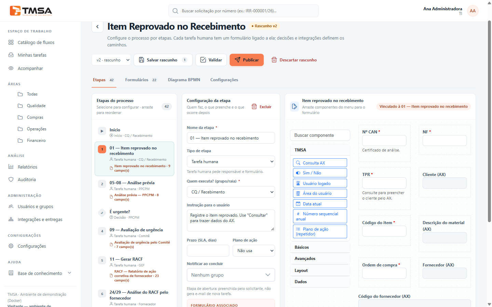
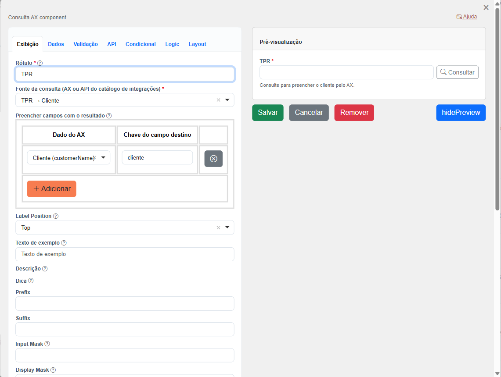
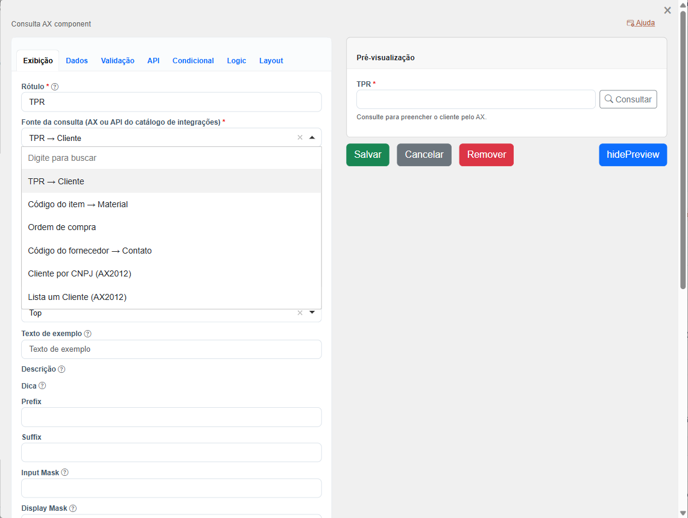

# Usar consultas nos formulários

Com o componente **Consulta AX**, o usuário digita um valor (um código, um CNPJ, uma ordem de compra),
clica em **Consultar** e o formulário se preenche sozinho com os dados do sistema externo.

Antes, a consulta precisa estar disponível. Há três formas:

- uma das **consultas prontas** do BPM, ligada a um serviço real (ou em modo simulado) — veja
  [Mapeamentos e modo simulado](guia-mapeamentos-e-mock.md);
- uma consulta criada pelo administrador em **Novo mapeamento** (tipo *Consulta no formulário*) — veja
  [Criar um novo mapeamento](guia-mapeamentos-e-mock.md#criar-um-novo-mapeamento);
- um serviço publicado diretamente como consulta ([Criar uma integração](guia-criar-integracao.md),
  etapa *Segurança e uso*).

> O componente se chama "Consulta AX", mas serve para **qualquer** sistema cadastrado nas integrações,
> não só para o AX.

## Passo 1 — Prepare os campos que serão preenchidos

Primeiro crie, no formulário, os campos que vão **receber** o resultado (por exemplo, "Cliente" e
"Cidade"). Recomendação: deixe esses campos como **somente leitura**, já que o valor vem da consulta.

Anote a **chave** de cada um (aba *API* da configuração do campo). Você vai precisar dela no passo 3.

## Passo 2 — Adicione o componente Consulta AX

No editor do formulário, o componente fica no grupo **TMSA**. Arraste **Consulta AX** para o formulário.

## Passo 3 — Configure a consulta

Abra a configuração do componente (ícone de engrenagem ao passar o mouse sobre ele).

1. **Rótulo** — o texto que o usuário vê acima do campo (ex.: "TPR").
2. **Fonte da consulta** — escolha o que consultar. Aparecem:
   - as consultas prontas do BPM: **TPR → Cliente**, **Código do item → Material**, **Ordem de compra** e
     **Código do fornecedor → Contato**;
   - as consultas criadas em **Novo mapeamento** e as publicadas pelo administrador, com o nome definido
     por ele e o sistema entre parênteses (ex.: "Cliente por CNPJ (AX2012)").

   

   Se uma consulta recém-criada não aparecer, **recarregue a página** do editor.
3. **Preencher campos com o resultado** — clique em **Adicionar** para cada informação a trazer:
   - **Dado do AX** — a informação devolvida pela consulta, mostrada como "Rótulo (chave)". A lista mostra
     informações de todas as consultas: escolha as da fonte selecionada;
   - **Chave do campo destino** — a chave do campo do formulário que vai receber o valor (a que você
     anotou no passo 1).

   Até 10 linhas por componente.
4. Clique em **Salvar**.

A **Pré-visualização**, à direita, já mostra o botão **Consultar**.

### Informações de cada consulta pronta

| Fonte | Informações disponíveis |
|---|---|
| TPR → Cliente | Código do cliente, Cliente |
| Código do item → Material | Descrição do material, Unidade |
| Ordem de compra | Código do fornecedor, Fornecedor, Situação da OC |
| Código do fornecedor → Contato | Fornecedor, Contato, Telefone, E-mail |

## Como funciona para quem preenche

- O campo ganha o botão **Consultar**. A consulta também acontece ao sair do campo depois de mudar o
  valor.
- Enquanto consulta, aparece "Consultando AX...". Depois:
  - **encontrou:** os campos se preenchem e aparece "Dados do AX carregados";
  - **não encontrou:** aparece "não foi encontrado no AX";
  - **sistema fora do ar:** aparece "O AX não responde. Tente novamente; seus dados não foram perdidos.";
  - **consulta desativada** (mapeamento inativo): aparece "A consulta … não está ativa no momento. Avise
    o administrador das integrações".
- O valor digitado pode ter até 60 caracteres.

## O que acontece ao enviar o formulário

Para garantir que ninguém altere os dados trazidos, **o BPM refaz a consulta no momento de salvar** e
usa o resultado dessa nova consulta:

- se o valor consultado **não for encontrado**, o formulário **não é enviado** e o usuário vê a
  mensagem para corrigir;
- se o sistema estiver **fora do ar**, o envio é recusado com "Seus dados não foram perdidos; tente
  novamente em instantes.";
- campos de consulta **vazios** ou **escondidos** por uma condição não são consultados;
- o BPM guarda um registro de cada consulta (o que foi consultado, o resultado e quando), exibido na
  visualização da resposta como "Consultas ao AX registradas".

> Consultas colocadas **dentro de um repetidor** (tabela de linhas) não são consultadas. Use a consulta
> fora do repetidor.

## Mostrar o resultado nas próximas etapas

Os campos preenchidos pela consulta passam a fazer parte dos dados do processo. Para mostrá-los em uma
etapa seguinte, adicione ao formulário daquela etapa **campos somente leitura com as mesmas chaves**.
Eles aparecem preenchidos com o que foi gravado; a consulta não é refeita.

Esses campos também podem ser usados nas **condições de decisão** do fluxo e nos **relatórios**, como
qualquer outro campo.

## Exemplo: processo de item reprovado no recebimento

Na etapa **01 — Item reprovado no recebimento** há três consultas:

| Campo de consulta | Fonte | Preenche |
|---|---|---|
| TPR | TPR → Cliente | Cliente |
| Código do item | Código do item → Material | Descrição do material |
| Ordem de compra | Ordem de compra | Código e nome do fornecedor |

Na etapa **11 — Gerar RACF**, o campo do código do fornecedor já vem preenchido pela etapa 01. O usuário
pode consultar de novo para atualizar nome, contato, telefone e e-mail do fornecedor.

## Limitações atuais

- Uma consulta que for **desligada ou despublicada** depois de usada no formulário para de funcionar: o
  botão mostra erro e, ao enviar, os campos de destino ficam vazios.
- "Não encontrado" **sempre** impede o envio do formulário.
- A chave do campo de destino precisa ser digitada.
- Ainda não é possível: lista de opções vinda do sistema externo, preencher um repetidor pela consulta
  ou transformar o valor antes de consultar (ex.: tirar a pontuação do CNPJ). O que está planejado está em
  [Próximos passos das integrações nos formulários](formio-consumo-endpoints.md).
- Qualquer usuário com acesso ao BPM pode usar qualquer consulta publicada.
