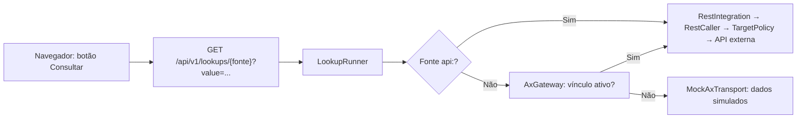

# Guia — Consumir uma integração num formulário Form.io (componente "Consulta AX")

Este guia mostra como o designer de formulários adiciona e configura o componente **"Consulta AX"** no
editor de formulários, como a consulta se comporta no preenchimento e no salvamento, e como reutilizar o
resultado em etapas seguintes, decisões e relatórios. Antes, publique a consulta no catálogo
([guia de criação de integração](guia-criar-integracao.md)) ou ligue a operação fixa a um endpoint real
([guia de mapeamentos e MOCK](guia-mapeamentos-e-mock.md)).

## O componente "Consulta AX"

No construtor de formulários, o componente está no grupo **"TMSA"**, com o rótulo **"Consulta AX"** (tipo
técnico `axlookup`). Ao arrastá-lo para o formulário, ele entra com a fonte `tpr` pré-selecionada.

> Nome histórico: o componente se chama "Consulta AX" mesmo quando a fonte é uma API REST qualquer do
> catálogo (o assistente de endpoints fala em "Consulta AX/API"). Algumas mensagens ao usuário também
> dizem "AX" para fontes REST.

### Configuração, campo a campo

Na aba de exibição da janela de configuração do componente:

1. **"Fonte da consulta (AX ou API do catálogo de integrações)"** (obrigatório) — lista as fontes
   disponíveis (veja a próxima seção). Fonte recém-publicada no catálogo só aparece após recarregar a
   página do editor (a lista vem nos metadados da sessão).
2. **"Preencher campos com o resultado"** — grade de de/para com **até 10 linhas** (limite aplicado pelo
   saneador do servidor), com as colunas:
   - **"Dado do AX"** — lista de campos da fonte, exibidos como "<rótulo> (<chave>)". A lista mistura os
     campos de todas as fontes; escolha os da fonte selecionada;
   - **"Chave do campo destino"** — digitada livremente. O hint é exato: "O campo destino deve existir no
     formulário (normalmente somente leitura)." O destino precisa ser a chave (`key`) de um campo já
     existente no formulário; caso contrário o saneador recusa o esquema.

Validações do saneador (servidor) para este componente:

- fonte inexistente no catálogo atual: "Selecione a fonte de consulta AX de \"<rótulo>\".";
- mapeamento com origem inexistente ou chave de destino inválida
  (`^[A-Za-z][A-Za-z0-9_]{0,62}$`): "Mapeamento de consulta AX inválido (<origem> → <destino>)." e
  somente as 10 primeiras linhas são aceitas;
- como em todo o Form.io do BPM, JavaScript livre, URLs externas, fontes externas de `select`, templates
  e propriedades de autenticação/upload são removidos ou recusados pelo saneador; rótulos e dicas viram
  texto puro (até 500 caracteres).

## As 3 formas de consumo

| Forma | Fonte no componente | Transporte |
|---|---|---|
| Consulta publicada do catálogo | `api:<identificador>` (rótulo definido na publicação) | chama o endpoint real diretamente — **sem vínculo e sem MOCK** |
| Consulta fixa do PO 159 | `tpr`, `item`, `purchaseOrder`, `supplier` | operação `*.lookup`: **vínculo ativo** → endpoint real; sem vínculo → MOCK |
| (sem componente) escrita pelo fluxo | — | operação `transferAndBlock` via etapa Integração: vínculo ativo → endpoint real; sem vínculo → MOCK ([guia da etapa Integração](guia-etapa-integracao.md)) |

Fontes fixas e seus campos (rótulos exatos do editor):

| Fonte | Rótulo | Campos disponíveis |
|---|---|---|
| `tpr` | "TPR → Cliente" | `customerCode` (Código do cliente), `customerName` (Cliente) |
| `item` | "Código do item → Material" | `itemDescription` (Descrição do material), `unit` (Unidade) |
| `purchaseOrder` | "Ordem de compra" | `supplierCode` (Código do fornecedor), `supplierName` (Fornecedor), `status` (Situação da OC) |
| `supplier` | "Código do fornecedor → Contato" | `supplierName` (Fornecedor), `contactName` (Contato), `phone` (Telefone), `email` (E-mail) |

Fontes `api:<id>`: endpoints **habilitados, GET e publicados** como consulta; o rótulo é o definido na
publicação seguido do sistema entre parênteses, e os campos são os liberados na etapa "Segurança e uso".

## Comportamento no preenchimento (navegador)

- O campo ganha o botão **"Consultar"**; a consulta também dispara ao alterar o valor. Valor vazio não
  consulta. O botão não aparece no construtor, em modo somente leitura ou com o campo desabilitado.
- Durante a chamada: "Consultando AX...". Sucesso: "Dados do AX carregados (&lt;transporte&gt;). O
  servidor confirma a consulta ao salvar." Não encontrado: "\"<valor>\" não foi encontrado no AX."
- Limites: o valor consultado tem **no máximo 60 caracteres** ("Informe o valor a consultar.") e a rota
  aceita **120 requisições por minuto** por usuário (`throttle:120,1`). A rota exige apenas autenticação:
  **qualquer usuário autenticado pode consultar qualquer fonte publicada**.
- Indisponibilidade: "O AX não responde. Tente novamente; seus dados não foram perdidos." (para fonte
  REST, "O <sistema> não respondeu. Tente novamente; seus dados não foram perdidos."), HTTP 503. Um erro
  4xx da API externa (diferente de 404) também vira "indisponível" para o usuário.
- Na **pré-visualização** do formulário a consulta chama o servidor de verdade (inclusive o MOCK, se for
  o transporte efetivo).

## Comportamento no servidor ao salvar

O navegador nunca é fonte de verdade. Ao salvar ou concluir a tarefa, o `SubmissionProcessor` refaz cada
consulta **dentro da transação da submissão** (a mesma que grava os dados, o outbox do engine e a
auditoria):

- os valores dos campos destino enviados pelo navegador são **ignorados** — os destinos são preenchidos
  só com o resultado da consulta refeita no servidor;
- consulta com valor **vazio** ou componente **oculto** pela condicional não é executada;
- fonte que **não existe mais** no catálogo (despublicada/desabilitada depois de usada no formulário) é
  simplesmente **pulada**, sem erro — os destinos ficam vazios;
- "não encontrado" vira **erro de validação** (HTTP 422): "\"<valor>\" não foi encontrado no <sistema>.";
- indisponibilidade vira **HTTP 503**: "Não foi possível consultar o <sistema> para \"<rótulo>\". Seus
  dados não foram perdidos; tente novamente em instantes.";
- cada consulta executada grava um snapshot em `metadata.lookups` da submissão: fonte (`source`), valor
  consultado (`value`), resultado completo (`result`), transporte (`transport`) e data/hora UTC (`at`).
  O diálogo de submissão exibe "Consultas ao AX registradas:" com `campo = "valor" (transport, data)` —
  o texto diz "AX" mesmo para fontes REST;
- a reconsulta vale apenas para componentes no **nível raiz** do formulário (inclusive dentro de painéis
  e layouts) — componentes "Consulta AX" **dentro de repetidor não consultam**.

## Exibir o resultado em etapas seguintes

Os campos preenchidos pela consulta são dados do processo. Para exibi-los em tarefas posteriores, o
designer adiciona **cópias somente leitura** desses campos (o blueprint do PO 159 usa o helper `copied`,
que clona o componente como somente leitura em painéis como "Dados da abertura"). Como a consulta só é
refeita na etapa em que o componente "Consulta AX" está, as etapas seguintes apenas leem os valores já
gravados.

## Usar em decisões e relatórios

- **Decisões (gateways)**: os campos destino podem ser usados nas condições da DSL de roteamento como
  qualquer outro campo do formulário (no PO 159, exemplos de campos usados em decisões são `urgente`,
  `procede`, `gefConcordaNp`, `validaAnalise`). O resultado da consulta entra na decisão por meio do
  campo destino — nunca por JavaScript.
- **Relatórios**: os campos destino são dados da instância e podem ser usados em relatórios; o snapshot
  `metadata.lookups` registra fonte, valor e transporte de cada consulta.

## Exemplo real do PO 159

Na etapa **"01 — Item reprovado no recebimento"** (`a01_abertura`), o blueprint
(`apps/api/database/seeders/Blueprints/Po159.php`) define três consultas:

| Campo de consulta | Rótulo | Fonte | Preenchimento |
|---|---|---|---|
| `tpr` | "TPR" | `tpr` | `customerName` → `cliente` |
| `codigoItem` | "Código do item" | `item` | `itemDescription` → `descricaoMaterial` |
| `ordemCompra` | "Ordem de compra" | `purchaseOrder` | `supplierCode` → `fornecedorCodigo`; `supplierName` → `fornecedorNome` |

Na etapa **"11 — Gerar RACF"** (`a11_gerar_racf`), a consulta `fornecedorCodigo` (fonte `supplier`)
preenche `fornecedorNome`, `fornecedorContato`, `fornecedorTelefone` e `fornecedorEmail`, com a
descrição "Pré-preenchido pela OC; consulte para atualizar o contato." — o campo já vem com o valor da
etapa 01 e o usuário pode reconsultar.

Para uma fonte `api:<id>`, o mesmo padrão vale: fonte `api:Fornecedores.PorCnpj` (exemplo), mapeando os
campos inferidos do endpoint para campos somente leitura do formulário.

## Limitações conhecidas

- **Fonte despublicada/desabilitada depois de usada**: o botão "Consultar" recebe 404 ("Fonte de consulta
  inexistente.") e, ao salvar, a consulta é **pulada sem erro** — os destinos ficam vazios. Reimportar o
  Swagger pode trocar os campos de saída publicados e esvaziar destinos.
- "Não encontrado" **sempre** é erro de validação no salvamento — não há como aceitar "não achou" como
  resultado válido.
- A lista "Dado do AX" mistura campos de todas as fontes e a chave de destino é digitada (sem
  preenchimento automático).
- Não há lista de opções vinda da API (`select` dinâmico), nem preenchimento de repetidor pela API, nem
  transformações declarativas (ex.: CNPJ sem pontuação, datas, `sim/não → 1/0`). O histórico e a
  recomendação de evolução estão em [formio-consumo-endpoints.md](formio-consumo-endpoints.md)
  (análise/roadmap — o que está marcado ❌/⚠ continua não implementado).
- Qualquer usuário autenticado pode consultar qualquer fonte publicada (não há permissão por fonte).
