# Criar uma integração

Este guia mostra, passo a passo, como cadastrar a ligação com um sistema externo (por exemplo, o
Dynamics AX), trazer os serviços dele para o BPM e deixá-los prontos para uso nos formulários e nos
fluxos.

Tudo acontece em **Administração → Integrações e entregas**.

## Antes de começar

- Você precisa de **permissão de administrador de configurações**. Sem ela, as abas *Conexões*,
  *Endpoints* e *Mapeamentos* não aparecem.
- Tenha em mãos o **endereço do sistema** (ex.: `https://apidax.tmsa.ind.br`) e o **usuário e senha de
  serviço** que a equipe do sistema externo forneceu para o BPM.
- Se o sistema fica na rede interna da empresa, peça à **equipe de TI** que libere o endereço dele no
  servidor do BPM. Sem isso, o teste mostra "Destino bloqueado" (veja
  [Acompanhar e resolver problemas](guia-operacao-e-suporte.md)).

## Passo 1 — Cadastrar a conexão

A **conexão** diz ao BPM onde o sistema está e como entrar nele. Abra a aba **Conexões**.

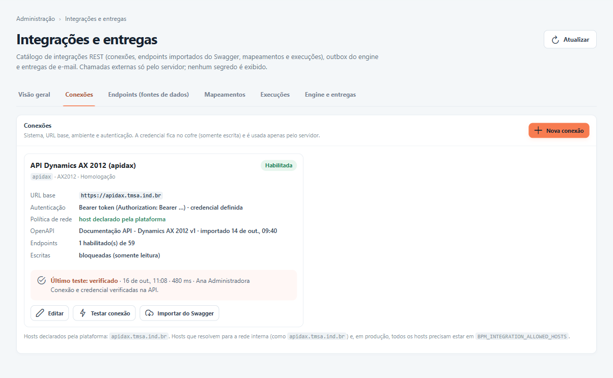

- Para o AX, use o botão **Conexão da API do AX (apidax)**: ele já preenche quase tudo. Esse botão só
  aparece enquanto a conexão do AX ainda não existe.
- Para outro sistema, use **Nova conexão**.
- Para alterar uma conexão existente, clique em **Editar** no cartão dela.

### Preencha os campos

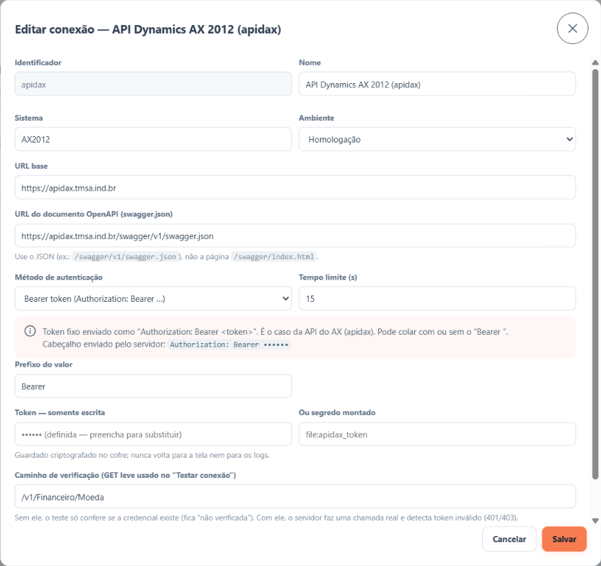

| Campo | O que colocar |
|---|---|
| **Identificador** | Um nome curto e único, sem espaços (ex.: `apidax`). Não pode ser alterado depois. |
| **Nome** | Como a conexão vai aparecer nas telas. |
| **Sistema** | O sistema de origem (ex.: `AX2012`). |
| **Ambiente** | Desenvolvimento, Homologação ou Produção. Em **Produção** o BPM não deixa testar gravações. |
| **URL base** | O endereço principal do sistema (ex.: `https://apidax.tmsa.ind.br`). |
| **URL do documento OpenAPI (swagger.json)** | O endereço do catálogo de serviços do sistema. Use o arquivo que termina em `swagger.json`, não a página visual do Swagger. |
| **Método de autenticação** | Como o BPM entra no sistema (veja abaixo). |
| **Tempo limite (s)** | Quanto tempo esperar por uma resposta antes de desistir. O padrão, 15 segundos, serve para a maioria dos casos. |
| **Caminho de verificação** | Um serviço simples de consulta que o botão **Testar conexão** vai chamar de verdade (ex.: `/v1/Financeiro/Moeda`). Recomendado: sem ele, o teste só confere se a senha foi preenchida. |

### Escolha a forma de entrar no sistema

| Opção | Quando usar | O que preencher |
|---|---|---|
| **Sem autenticação** | Sistemas internos abertos, que não pedem senha. | Nada. |
| **Bearer token** | O sistema forneceu um código de acesso fixo (é o caso da conexão atual do AX). | O código no campo **Token**. |
| **Basic (usuário e senha)** | O sistema pede usuário e senha em toda chamada. | **Usuário** e senha. |
| **Chave de API em cabeçalho** | O sistema forneceu uma chave de acesso. | O **nome do cabeçalho** que o sistema informou e a chave. |
| **Login do usuário de serviço → token** | O sistema exige login com usuário e senha e devolve um código temporário. **Recomendado para o AX.** | **Caminho do login** (ex.: `/v1/User/login`), **Usuário de serviço** e senha. O BPM renova o código sozinho. |
| **OAuth2 client credentials** | Sistemas na nuvem que usam esse padrão. | Endereço de obtenção do código, **Client ID** e **Client secret**, informados pelo fornecedor. |

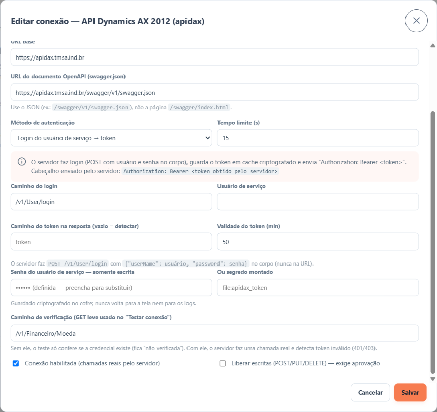

**Sobre a senha:**

- O campo da senha é **somente escrita**: depois de salva, ela aparece como "•••••• (definida — preencha
  para substituir)" e nunca mais é exibida.
- Para manter a senha atual, **deixe o campo vazio** ao salvar. Para trocar, digite a nova.
- O campo **Ou segredo montado** é usado quando a equipe de TI guarda a senha no próprio servidor.
  Preencha só se ela pedir.
- **Nunca coloque a senha no endereço** nem nos parâmetros dos serviços. O BPM recusa.

### Ligar a conexão e liberar gravações

No fim da janela há duas caixas:

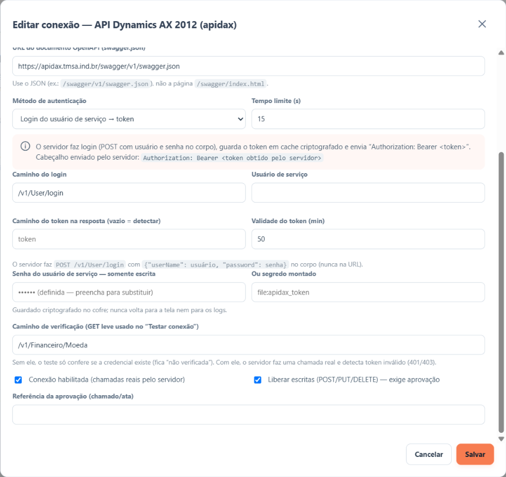

- **Conexão habilitada** — enquanto estiver desmarcada, o BPM não faz nenhuma chamada a esse sistema.
- **Liberar escritas (POST/PUT/DELETE) — exige aprovação** — necessária apenas para serviços que
  **gravam** no sistema externo. Ao marcar, preencha **Referência da aprovação** com o número do
  chamado ou da ata que autorizou. Sem essa liberação, toda gravação é recusada; consultas continuam
  funcionando.

Clique em **Salvar**.

### Testar a conexão

No cartão da conexão, clique em **Testar conexão**. O resultado aparece no próprio cartão:

| Resultado | O que significa |
|---|---|
| **Último teste: verificado** | O BPM entrou no sistema e chamou o serviço de verificação com sucesso. |
| **Último teste: credencial não verificada** | Não há caminho de verificação: o BPM só conferiu que a senha está preenchida. Preencha o **Caminho de verificação** para um teste real. |
| **Último teste: falhou** | Algo deu errado. O cartão mostra o motivo e, em **O que fazer:**, a ação recomendada. |

A linha **Política de rede** do cartão mostra se o endereço está liberado. Se aparecer um bloqueio,
peça à equipe de TI para liberar o endereço do sistema.

## Passo 2 — Importar os serviços do Swagger

O Swagger é a lista de serviços que o sistema externo publica. Em vez de cadastrar cada serviço à mão,
o BPM lê essa lista para você.

1. No cartão da conexão, clique em **Importar do Swagger**.

   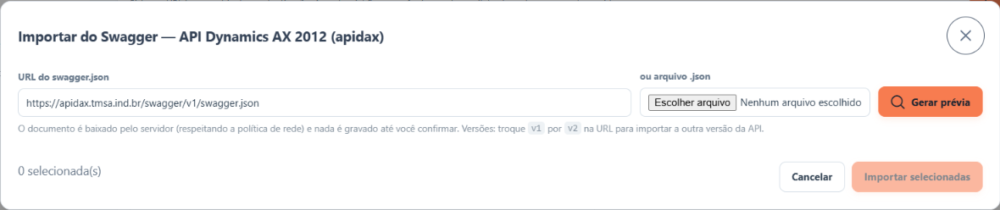

2. Confira o endereço em **URL do swagger.json**. Se o sistema tiver mais de uma versão, troque `v1` por
   `v2` no endereço. Se o servidor do BPM não conseguir acessar o endereço, peça o arquivo à equipe do
   sistema e use **ou arquivo .json**.
3. Clique em **Gerar prévia**. **Nada é gravado nesta etapa.**

   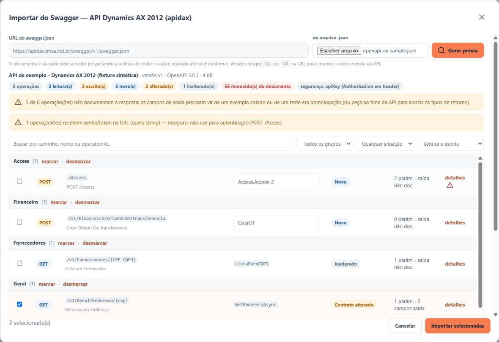

4. Revise a lista:
   - os serviços aparecem **agrupados por assunto**, com a situação **Novo**, **Contrato alterado** (o
     sistema mudou esse serviço desde a última importação) ou **Inalterado**;
   - os filtros no topo ajudam a achar serviços por nome ou grupo e a separar consultas de gravações;
   - **detalhes** mostra o que o serviço recebe e devolve;
   - o triângulo de alerta indica algo a observar, como um serviço que pede senha no endereço (não use)
     ou que não informa o que devolve.
5. Por padrão vêm marcadas as **consultas novas ou alteradas**. Ajuste a seleção e clique em
   **Importar selecionadas**.

Os serviços importados chegam **desligados**. Nada é usado até você revisar e ligar cada um.

> A prévia vale por 30 minutos. Depois disso, gere de novo.

**Importando de novo:** sempre que o sistema externo mudar, repita a importação. O BPM atualiza os
serviços alterados **sem perder** o que você já configurou (nomes, campos de saída, publicação nos
formulários e mapeamentos). Serviços que saíram do catálogo ficam marcados como **removido**, mas não são
apagados. O BPM também confere o catálogo uma vez por dia e marca o que mudou.

## Passo 3 — Completar cada endpoint

Abra a aba **Endpoints (fontes de dados)**. A lista mostra todos os serviços, com filtros à esquerda.

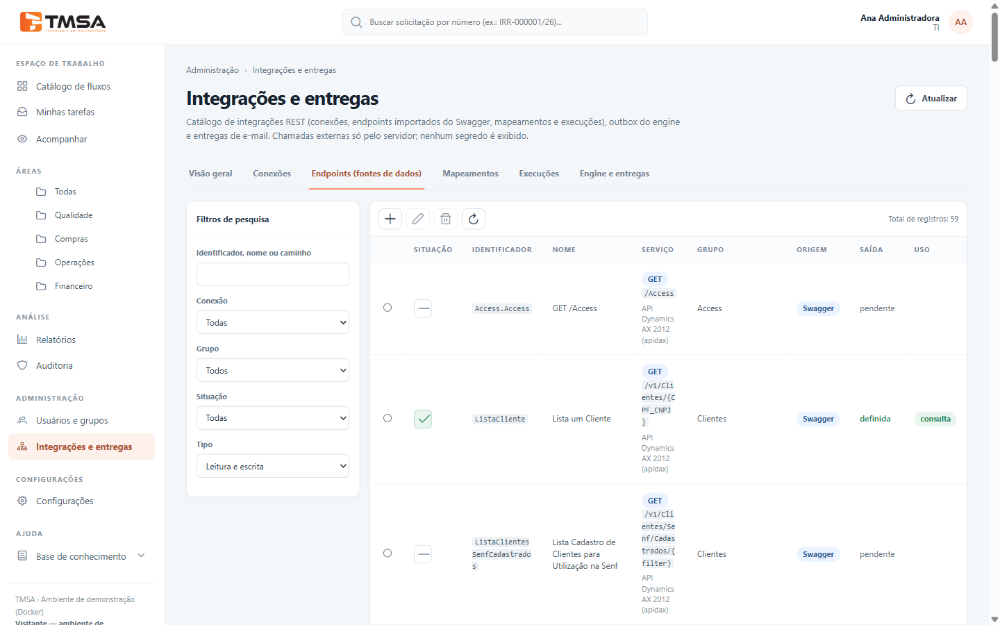

| Coluna | O que mostra |
|---|---|
| **Situação** | Marcado = ligado; traço = desligado. Clique para ligar ou desligar. |
| **Saída** | **definida** = o BPM já sabe o que o serviço devolve; **pendente** = falta configurar. |
| **Uso** | **consulta** = liberado para formulários; **escrita** = grava no sistema externo. |

Selecione um serviço e clique no lápis (**Editar**). Abre um assistente de 5 etapas. Use **Próximo** e
**Anterior** para navegar e **Finalizar** para salvar.

### Etapa 1 — Dados do serviço

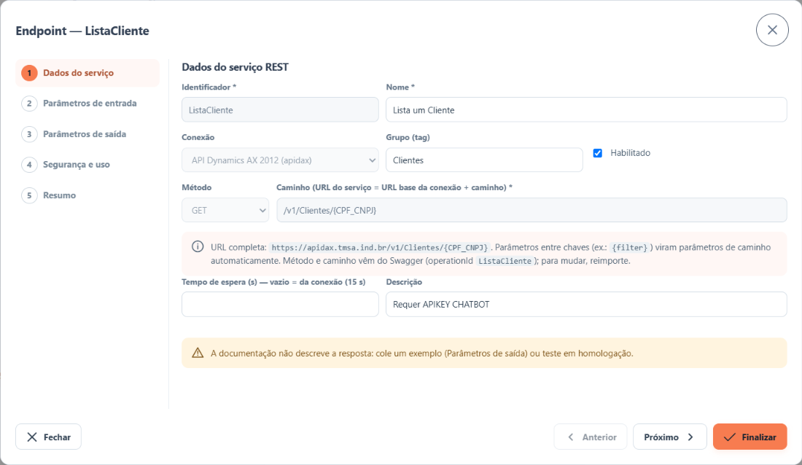

- Revise o **Nome** (é como o serviço aparece para os outros administradores) e o **Grupo**.
- Marque **Habilitado** quando o serviço estiver pronto para uso.
- **Método** e **Caminho** vêm do Swagger e não podem ser alterados aqui. Para mudar, importe de novo.
- **Tempo de espera** vazio usa o tempo da conexão.
- Se o sistema externo mudou esse serviço, aparece o aviso **Contrato alterado no Swagger**. Importe de
  novo pela conexão ou, se estiver tudo certo, marque **Revisei: manter como está**.

### Etapa 2 — Parâmetros de entrada

O que o serviço precisa receber para funcionar (por exemplo, o CNPJ a consultar).

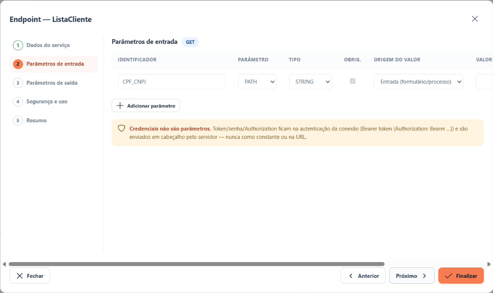

Em **Origem do valor**, escolha:

- **Entrada (formulário/processo)** — o valor vem de quem usa o serviço (o que o usuário digitou ou um
  dado do processo);
- **Constante** — um valor fixo, enviado sempre. Use só para valores que **não são senha**.

### Etapa 3 — Parâmetros de saída

O que o serviço devolve (por exemplo, nome, cidade e estado do cliente). Só esses campos podem preencher
formulários.

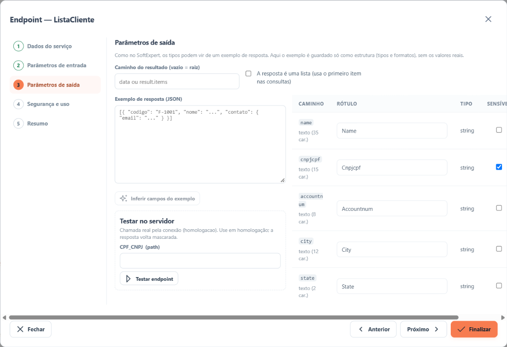

O catálogo do AX não informa o que cada serviço devolve. Por isso é preciso ensinar o BPM, de uma destas
formas:

- **Pelo exemplo:** cole em **Exemplo de resposta (JSON)** um exemplo do que o serviço devolve (pode ter
  valores inventados, desde que a estrutura seja a mesma) e clique em **Inferir campos do exemplo**. O
  exemplo é guardado sem os valores.
- **Pelo teste:** em **Testar no servidor**, informe um valor e clique em **Testar endpoint**. O BPM chama
  o sistema de verdade e mostra a resposta mascarada. Depois clique em **Usar os N campo(s) desta
  resposta**. Faça isso em **homologação**.

Depois, revise a tabela:

- ajuste o **Rótulo** de cada campo para algo que as pessoas entendam;
- marque **Sensível** em campos com dados pessoais (CPF, telefone, e-mail etc.). Eles ficam escondidos no
  histórico e exigem confirmação para aparecer em formulários.

Se a informação útil vier "dentro" de outra (por exemplo, numa lista chamada `data`), informe isso em
**Caminho do resultado**. Se o serviço devolver uma lista, marque **A resposta é uma lista**: o BPM usa o
primeiro item.

> **Testar uma gravação** grava de verdade no sistema externo. O BPM pede uma confirmação, exige que as
> escritas estejam liberadas na conexão e não deixa testar em conexões de Produção.

### Etapa 4 — Segurança e uso

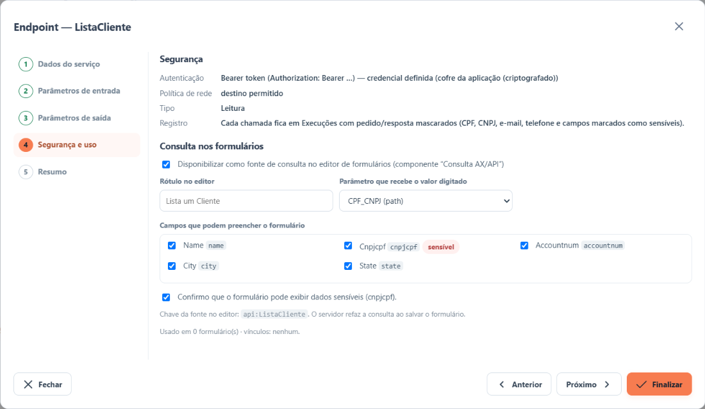

A parte de cima resume como o BPM entra no sistema e se o endereço está liberado.

Para que o serviço apareça no editor de formulários, marque **Disponibilizar como fonte de consulta no
editor de formulários** e preencha:

- **Rótulo no editor** — o nome que quem monta o formulário vai ver;
- **Parâmetro que recebe o valor digitado** — qual entrada do serviço recebe o que o usuário digitar;
- **Campos que podem preencher o formulário** — marque só o necessário. Se escolher um campo sensível,
  confirme que o formulário pode exibi-lo.

Apenas serviços de **consulta** podem ser usados em formulários. Serviços que gravam são usados em
etapas automáticas do fluxo (veja [Mapeamentos e modo simulado](guia-mapeamentos-e-mock.md)).

### Etapa 5 — Resumo

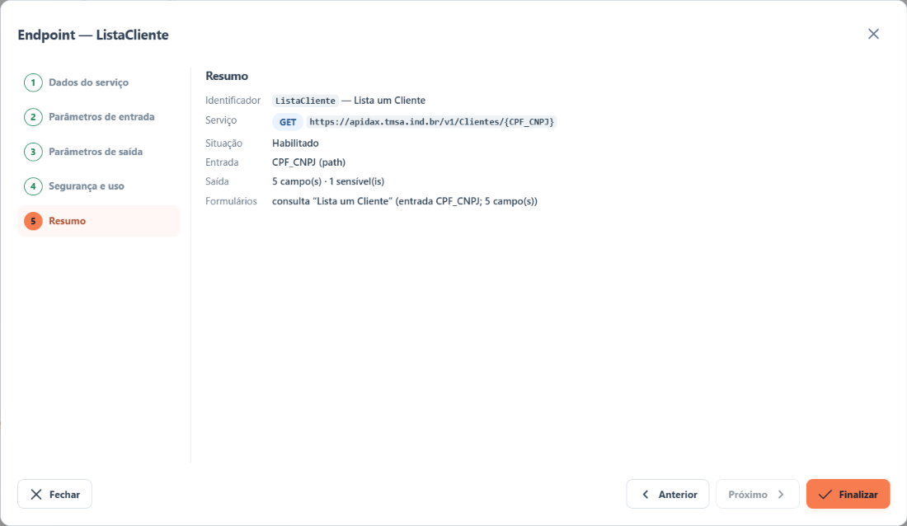

Confira tudo e clique em **Finalizar**.

> Um serviço usado por algum formulário ou mapeamento **não pode ser removido**. Primeiro tire-o de uso.

## Passo 4 — Ligar e usar

1. Ligue o serviço (caixa **Habilitado**, na etapa 1, ou a coluna **Situação** da lista) e a conexão
   (**Conexão habilitada**).
2. A consulta já aparece no editor de formulários: veja
   [Usar consultas nos formulários](guia-consumir-formulario.md).
3. Para ligar as operações prontas do BPM (consultas do processo de item reprovado e a gravação no AX),
   use a aba *Mapeamentos*: veja [Mapeamentos e modo simulado](guia-mapeamentos-e-mock.md).
4. Acompanhe as chamadas na aba *Execuções*: veja
   [Acompanhar e resolver problemas](guia-operacao-e-suporte.md).
