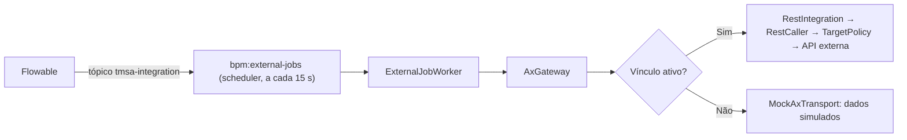

# Guia — Etapa do tipo Integração no workflow

Este guia mostra como o designer de fluxos adiciona uma etapa do tipo **Integração** (tarefa de serviço),
como ela é executada pelo engine e pelo worker, o que acontece em falhas e como exibir as saídas no
formulário da etapa seguinte. Para ligar a operação a um endpoint real (ou entender o MOCK), veja o
[guia de mapeamentos e MOCK](guia-mapeamentos-e-mock.md). Decisão:
[ADR-0006](../adr/0006-integracao-ax-2012-r3.md).

## Adicionar a etapa

No editor de fluxos, a paleta de etapas tem o botão **"Adicionar integração"**. A etapa entra com o nome
padrão **"Nova integração"** e chave gerada a partir de `integracao`. Na lista de etapas e no diagrama o
tipo aparece como **"Integração"** (tipo técnico `service_task`, ícone de engrenagem).

## Configurar

A única configuração da etapa é o campo **"Integração executada"** (opção vazia "Selecione..."), que
lista as operações do catálogo de integrações. Hoje o catálogo tem uma única operação:

- `ax.transferAndBlock` — "AX: diário de transferência, marcação da OCDev na OC e bloqueio do item".

Ao escolher a operação, a tela mostra o hint **"Grava no processo: numeroDiarioTransferencia,
ocdevMarcadaNaOc, itemBloqueado"** — as saídas que a operação grava nos dados do processo. As entradas
exigidas (`numeroOcdev`, `codigoItem`, `ordemCompra`) são lidas dos dados do processo; o editor **não
mostra** essas entradas nem confere se elas existem — garanta que etapas anteriores as preencheram (no PO
159, são os campos das consultas da etapa 01). Não há outras opções na etapa.

## Validações e BPMN

- **Publicação**: o validador exige a operação — "Selecione a integração executada por \"<nome>\"."
  (código `service_operation`).
- **Importação de BPMN**: o elemento precisa ser `serviceTask` com `flowable:type="external-worker"` e a
  operação precisa existir no catálogo; caso contrário: "Integração \"<nome>\": selecione uma operação do
  catálogo de integrações TMSA."
- **XML gerado** (BPMN 2.0):

```xml
<serviceTask id="..." name="..." flowable:type="external-worker" flowable:topic="tmsa-integration">
  <extensionElements>
    <tmsa:integration operation="ax.transferAndBlock"/>
  </extensionElements>
</serviceTask>
```

## Como a execução acontece



1. O agendador roda `php artisan bpm:external-jobs` **a cada 15 segundos** (`withoutOverlapping`,
   `onOneServer`), que busca até **10 jobs** do tópico `tmsa-integration` com **trava de PT5M** no
   Flowable.
2. Para cada job, o `ExternalJobWorker` localiza a instância e a etapa, lê a operação do catálogo e monta
   as **entradas a partir dos dados do processo** (apenas as chaves declaradas na operação).
3. A chamada usa a **chave de idempotência `<instância>:<elemento>:<job>`** — a mesma tentativa nunca
   grava duas vezes, e uma escrita já concluída com aquela chave devolve as saídas gravadas sem reenviar.
4. As **saídas** (filtradas pelas chaves do catálogo) são gravadas nos dados do processo, em transação,
   e devolvidas ao Flowable ao completar o job — ficam disponíveis também como **variáveis do processo**
   no engine. A projeção da instância é sincronizada em seguida.
5. Auditoria: sucesso grava `integration.completed` ("Integração concluída"); falha grava
   `integration.failed` ("Integração falhou"). A linha do tempo da instância mostra **"Integração
   executada"** ou **"Falha de integração (nova tentativa agendada)"**.

Cada chamada também aparece na aba **Execuções** (pedido/resposta mascarados, HTTP, duração, chave de
idempotência e correlation ID) — veja o [guia de operação e suporte](guia-operacao-e-suporte.md).

## Falhas e tentativas

- Falha de integração (API fora, erro 4xx/5xx, destino bloqueado etc.): o worker agenda **nova tentativa
  em 5 minutos (PT5M)**, consumindo uma tentativa. O número de tentativas vem do Flowable (padrão de
  fábrica: 3).
- Instância ou operação não encontrada: nova tentativa em 2 minutos (PT2M), também consumindo tentativa.
- Esgotadas as tentativas, o job fica em **dead-letter** no Flowable para análise — **não há tela de
  retomada no BPM**; a instância fica parada na etapa de integração até intervenção.
- Erro inesperado (exceção fora dos tipos tratados) é apenas registrado em log ("Falha no worker de
  integração") **sem consumir tentativa**: o job volta a ser pego quando a trava expira (ciclo de ~5
  minutos, indefinidamente).
- A falha **não muda o status da instância** nem aparece em "Etapas atuais": o acompanhamento é pela
  linha do tempo, pela aba Execuções e pela auditoria.

### Cenários de falha

| Cenário | Resultado | O que acontece |
|---|---|---|
| Sem vínculo ativo (padrão) | MOCK | a escrita simulada sempre "funciona" e grava `DT-######` nos dados |
| Vínculo ativo, endpoint/conexão desabilitado | falha (`not_configured`) | nova tentativa a cada 5 min até habilitar ou esgotar — **não volta ao MOCK** |
| API recusa (4xx ≠ 404), credencial, 5xx, limite | falha (`request_rejected`, `credential_invalid`, `forbidden`, `provider_error`, `throttled`…) | nova tentativa a cada 5 min |
| Escrita sem liberação na conexão | falha (`write_not_allowed`) | nova tentativa; libere as escritas com a referência de aprovação |
| **Tempo esgotado após o envio** (escrita) | **resultado incerto (`unknown`)** | a repetição é bloqueada (`reconciliation_required`) até reconciliar na aba Execuções |
| HTTP 404 na escrita | **conta como sucesso, com saídas vazias** | confira o contrato do endpoint se isso não fizer sentido para a operação |
| Tentativas esgotadas | dead-letter | sem retomada pela tela; intervenção manual |

### Reconciliação de escrita incerta (e a janela de tempo)

Quando uma escrita esgota o tempo **depois** de enviada, o sistema de destino pode ter gravado. Por
isso a execução fica `unknown` e a próxima tentativa falha com `reconciliation_required` em vez de
reenviar. Enquanto houver tentativas (nova tentativa a cada 5 minutos — com o padrão de 3 tentativas, a
janela é de poucos minutos), alguém com `processes.manage` deve abrir **Execuções → Reconciliar** e
informar "Foi executada" (com as saídas, que a próxima tentativa devolve sem reenviar) ou "Não foi
executada" (a próxima tentativa reenvia). Detalhes e textos da janela:
[guia de operação e suporte](guia-operacao-e-suporte.md).

## Exibir as saídas no formulário seguinte e usar em decisões

As saídas ficam nos dados do processo com os nomes declarados na operação. Para exibi-las, o formulário
da etapa seguinte traz campos **somente leitura** com essas chaves. No PO 159:

- a etapa de integração é `s40_ax` ("AX: diário, marcação OCDev e bloqueio"), no caminho
  `m_qualidade → s40_ax → a40_separacao → a41_frete` — `m_qualidade` recebe os caminhos de
  `a39_fiscal_ocdev`, de `a45_sup_ocdev` (via `g46_nf_espelho`) e de `a47_nf_espelho` (via `m_trilha_b`);
- a etapa seguinte, **"40 — Separação, entrega e transferência"** (`a40_separacao`), exibe as saídas como
  campos somente leitura: "Nº do diário de transferência (AX)", "OCDev marcada na OC de origem (AX)" e
  "Item bloqueado para outras necessidades (AX)", junto da confirmação manual "Confirmo a separação e a
  entrega física do material".

Como as saídas viram dados e variáveis do processo, também podem ser usadas em **condições de decisão**
(gateways) pela DSL de roteamento.

## Onde acompanhar

- **Linha do tempo** da instância (e da tarefa): eventos "Integração executada" e "Falha de integração
  (nova tentativa agendada)".
- **Administração → Integrações e entregas → Execuções**: cada tentativa com resultado, HTTP, duração,
  pedido/resposta mascarados, chave de idempotência e correlation ID.
- **Auditoria**: `integration.completed` e `integration.failed`.
- A etapa de integração **não aparece em "Etapas atuais"** (só tarefas humanas aparecem) nem é destacada
  no diagrama da instância — enquanto as tentativas acontecem, a instância segue "em andamento" parada
  naquele ponto do fluxo.
