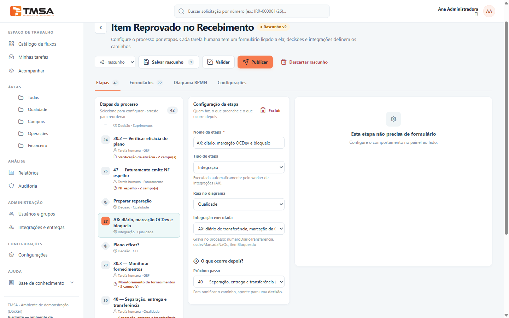

# Etapa do tipo Integração

Uma etapa do tipo **Integração** é uma etapa **automática** do fluxo: ninguém precisa abrir uma tarefa.
Quando o processo chega nela, o BPM executa a operação escolhida no sistema externo (por exemplo, gravar
um diário de transferência no AX), guarda o resultado nos dados do processo e segue para a próxima
etapa.

A operação executada pode ser:

- a **operação pronta** do AX (diário de transferência e bloqueio), que usa o modo simulado até ser
  ligada a um serviço real na aba *Mapeamentos*;
- uma **etapa automática criada em Novo mapeamento**, para qualquer serviço cadastrado (consultar ou
  gravar). Veja [Criar um novo mapeamento](guia-mapeamentos-e-mock.md#criar-um-novo-mapeamento).

## Passo 1 — Adicionar a etapa

1. Abra o fluxo no editor (**Catálogo de fluxos → editar**), na aba **Etapas**.
2. Clique em **Adicionar integração**. A etapa entra com o nome "Nova integração".
3. Renomeie a etapa com algo que explique o que ela faz (ex.: "AX: diário, marcação OCDev e bloqueio").

Na lista de etapas e no diagrama, ela aparece com o tipo **Integração** e um ícone de engrenagem.

## Passo 2 — Configurar

Selecione a etapa. O painel **Configuração da etapa** mostra:

- **Tipo de etapa:** Integração.
- **Raia no diagrama:** a área em que a etapa aparece no desenho do processo.
- **Integração executada:** escolha a operação. A lista traz a operação pronta **AX: diário de
  transferência, marcação da OCDev na OC e bloqueio do item** e as etapas automáticas criadas em **Novo
  mapeamento** (as inativas aparecem com "(inativa)").
- Logo abaixo aparece o que a operação **lê do processo** e o que ela **grava no processo**. Na operação
  pronta, ela lê número da OCDev, código do item e ordem de compra, e grava o número do diário de
  transferência, se a OCDev foi marcada na OC e se o item foi bloqueado.
- **Próximo passo:** para qual etapa o processo segue depois.

Essa etapa **não tem formulário**.

> **Importante:** a operação usa informações preenchidas em etapas anteriores (as que aparecem em "Lê do
> processo"). O editor não confere se elas existem. Garanta que alguma etapa anterior do fluxo as
> preencha, com a mesma chave.

Ao **Validar** ou **Publicar** o fluxo, o BPM avisa:

- se faltar escolher a integração: "Selecione a integração executada por …";
- se a etapa usar um mapeamento novo **inativo**: "… está com o mapeamento inativo: a etapa vai falhar
  até ativá-lo em Integrações → Mapeamentos."

> Quem estava com o editor aberto antes de o mapeamento ser criado precisa **recarregar a página** para
> vê-lo na lista.

## Como a etapa é executada

1. Quando o processo chega na etapa, o BPM a executa automaticamente em poucos segundos.
2. A operação usa os dados do processo e chama o sistema externo (a operação pronta responde em modo
   simulado se não houver mapeamento ativo).
3. O resultado é gravado nos dados do processo e o processo segue para o próximo passo.
4. A linha do tempo da solicitação registra **Integração executada**.

Cada tentativa também aparece na aba *Execuções* de **Integrações e entregas**.

## Quando algo dá errado

Se a chamada falhar (sistema fora do ar, senha recusada, serviço desligado etc.):

- o BPM **tenta de novo a cada 5 minutos**, algumas vezes (normalmente 3 tentativas);
- a linha do tempo mostra **Falha de integração (nova tentativa agendada)**;
- enquanto isso, a solicitação continua "em andamento", **parada nessa etapa**. Ela não aparece em
  "Etapas atuais", porque só tarefas de pessoas aparecem ali.

| Situação | O que acontece | O que fazer |
|---|---|---|
| Operação pronta sem mapeamento ativo | Funciona em **modo simulado** e grava um número fictício (DT-…). | Ligue o mapeamento antes de usar o processo de verdade. |
| Mapeamento novo inativo | Falha e tenta de novo (não há modo simulado). | Ative o mapeamento na aba *Mapeamentos*. |
| Mapeamento ativo, mas serviço ou conexão desligado | Falha e tenta de novo. | Ligue o serviço e a conexão. |
| Sistema externo recusou, senha inválida, fora do ar | Falha e tenta de novo. | Veja o motivo em *Execuções* e corrija. |
| Gravação não liberada na conexão | Falha e tenta de novo. | Libere as escritas na conexão, com o número da aprovação. |
| **Demorou demais depois de enviar** | O BPM não sabe se gravou e **não repete** até alguém conferir. | **Reconcilie** em *Execuções* (veja abaixo). |
| Todas as tentativas esgotadas | A solicitação fica parada nessa etapa. | Acione o suporte técnico: hoje não há como retomar pela tela. |

### Quando o BPM não sabe se gravou

Se o sistema externo demorar demais **depois** de receber a gravação, pode ser que ele tenha gravado.
Para não gravar em dobro, o BPM bloqueia as novas tentativas até alguém conferir.

Alguém com permissão de gestão de processos deve, **o quanto antes** (as tentativas acontecem a cada 5
minutos):

1. conferir no sistema externo se a gravação aconteceu;
2. abrir **Integrações e entregas → Execuções**, localizar a chamada com **Resultado incerto** e clicar em
   **Reconciliar**;
3. escolher **Foi executada** (e informar o resultado, como o número do diário) ou **Não foi executada**
   (a próxima tentativa envia de novo).

Detalhes em [Acompanhar e resolver problemas](guia-operacao-e-suporte.md).

## Mostrar o resultado na etapa seguinte

O resultado da integração fica nos dados do processo. Para mostrá-lo, adicione ao formulário da etapa
seguinte **campos somente leitura** com as chaves que a operação grava.

No processo de item reprovado no recebimento, a etapa **40 — Separação, entrega e transferência**, logo
depois da integração, mostra:

- Nº do diário de transferência (AX);
- OCDev marcada na OC de origem (AX);
- Item bloqueado para outras necessidades (AX).

Esses valores também podem ser usados nas **condições de decisão** do fluxo.

## Onde acompanhar

- **Linha do tempo** da solicitação: "Integração executada" ou "Falha de integração (nova tentativa
  agendada)".
- **Integrações e entregas → Execuções:** cada tentativa, com resultado, tempo e detalhes.
- **Auditoria:** "Integração concluída" e "Integração falhou".
