# Mapeamentos e modo simulado (MOCK)

Um **mapeamento** diz ao BPM qual serviço do sistema externo chamar e qual informação vai para onde.
Existem dois tipos:

- **Operações prontas** — já vêm com o BPM e são usadas pelo processo de item reprovado no recebimento:
  quatro consultas nos formulários e uma gravação no AX. Enquanto não são ligadas a um serviço real,
  funcionam em **modo simulado**.
- **Mapeamentos novos (personalizados)** — criados por você em **Novo mapeamento**, para qualquer
  processo: uma **consulta no formulário** ou uma **etapa automática do fluxo**.

Antes, cadastre a conexão e os serviços pelo guia [Criar uma integração](guia-criar-integracao.md).

## O modo simulado (MOCK)

Enquanto uma operação pronta não está ligada a um serviço real, ela funciona em **modo simulado**: o BPM
responde com **dados fictícios** e não acessa nenhum sistema. Isso permite montar, demonstrar e testar
os processos antes de a integração estar pronta.

Onde você vê que está em modo simulado:

- na pílula âmbar **MOCK** da *Visão geral* e da aba *Mapeamentos*;
- no aviso da *Visão geral*: "N operação(ões) do BPM ainda em MOCK (dados simulados)";
- na mensagem do formulário depois de consultar, e no histórico da aba *Execuções*.

> Mapeamentos novos **não** têm modo simulado: enquanto estiverem inativos, a consulta ou a etapa não
> funciona.

### Dados fictícios devolvidos

| Operação | O que o modo simulado devolve |
|---|---|
| Consulta TPR → Cliente | Um cliente fictício, como "Cliente Exemplo Ltda (fictício)". |
| Consulta Código do item → Material | Uma descrição fictícia, como "Rolamento 6205", com unidade PC ou KG. |
| Consulta Ordem de compra | Um fornecedor fictício e a situação "Recebida parcialmente". |
| Consulta Código do fornecedor → Contato | Só encontra os códigos **F-1001**, **F-1002** e **F-1003** (Fornecedores Alfa, Beta e Gama, fictícios). |
| Gravação no AX (diário de transferência e bloqueio) | Um número de diário fictício no formato **DT-000000** e a confirmação de que a OCDev foi marcada e o item bloqueado. |

Para testar situações especiais nas consultas:

- digite um valor começando com **NAOEXISTE** (ex.: `NAOEXISTE123`) para simular "não encontrado";
- digite um valor começando com **INDISPONIVEL** para simular o sistema fora do ar.

> **Atenção:** os dados simulados são gravados no processo como se fossem reais. Um processo real
> executado em modo simulado terá números fictícios (ex.: `DT-…`). Confira a aba *Mapeamentos* antes de
> colocar um processo em uso.

## A aba Mapeamentos

Abra **Administração → Integrações e entregas → Mapeamentos**. A tela tem duas partes: em cima, as
operações prontas; embaixo, os **mapeamentos personalizados**. O botão **Novo mapeamento** fica no
canto superior direito.

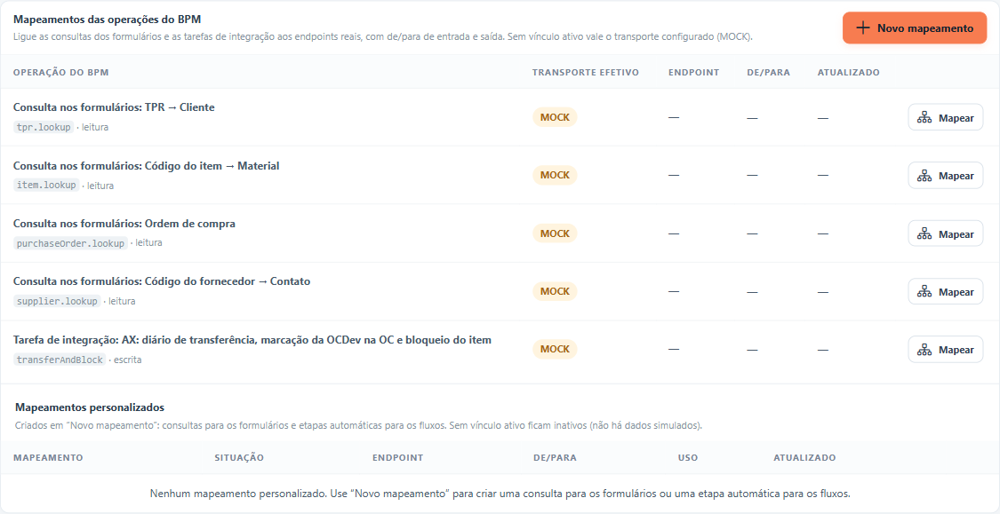

### Operações prontas

| Operação | Tipo | Onde é usada |
|---|---|---|
| **Consulta nos formulários: TPR → Cliente** | consulta | Componente *Consulta AX* com a fonte "TPR → Cliente". |
| **Consulta nos formulários: Código do item → Material** | consulta | Fonte "Código do item → Material". |
| **Consulta nos formulários: Ordem de compra** | consulta | Fonte "Ordem de compra". |
| **Consulta nos formulários: Código do fornecedor → Contato** | consulta | Fonte "Código do fornecedor → Contato". |
| **Tarefa de integração: AX: diário de transferência, marcação da OCDev na OC e bloqueio do item** | gravação | Etapa do tipo *Integração* no fluxo. |

A coluna **Transporte efetivo** mostra como cada operação está funcionando agora:

| Pílula | O que significa |
|---|---|
| **MOCK** (âmbar) | Modo simulado: dados fictícios. |
| **REST (real)** (verde) | Ligada a um serviço real, com serviço e conexão ligados. |
| **REST — endpoint/conexão desligado** (vermelho) | Ligada a um serviço real, mas o serviço ou a conexão está desligado. **A operação falha** até você ligá-los; ela **não** volta sozinha ao modo simulado. |

## Ligar uma operação pronta a um serviço real

Clique em **Mapear** na linha da operação.

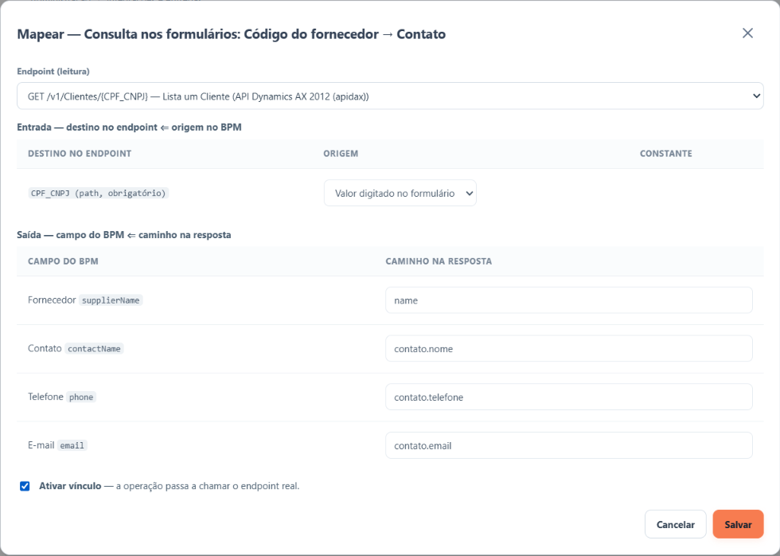

1. **Endpoint** — escolha o serviço real. Consultas só aceitam serviços de consulta. A opção **Nenhum
   (usar transporte configurado)** desfaz a ligação.
2. **Entrada** — para cada informação que o serviço precisa receber (**Destino no endpoint**), escolha de
   onde ela vem (**Origem**):
   - **Valor digitado no formulário** (nas consultas) ou um dado do processo (na gravação);
   - **Valor constante** — um texto fixo, que não seja senha;
   - **— não enviar —**.

   Se o serviço precisar de um campo que o catálogo não mostra, digite o nome dele no campo **campo do
   corpo não documentado** e clique em **Adicionar**.
3. **Saída** — para cada informação que o BPM espera (**Campo do BPM**), informe onde ela está na
   resposta do serviço (**Caminho na resposta**), por exemplo `nome` ou `contato.email`. A lista sugere os
   campos que você configurou em *Parâmetros de saída* do serviço.
4. Marque **Ativar vínculo** para que a operação passe a usar o serviço real.
5. Clique em **Salvar**.

Mensagens ao salvar:

- "Vínculo ativo: a operação passa a chamar o endpoint real." — pronto, já vale.
- "Vínculo salvo (inativo: continua no transporte configurado)." — a configuração foi guardada, mas a
  operação continua em modo simulado até você marcar **Ativar vínculo**.

## Criar um novo mapeamento

Use **Novo mapeamento** quando um processo precisar de uma integração que não está entre as operações
prontas. Por exemplo:

- **Consulta no formulário:** o usuário digita o CNPJ e o formulário traz nome, cidade e UF do cliente;
- **Etapa automática do fluxo:** depois da abertura, o processo confere sozinho o cliente no AX e guarda
  o nome nos dados do processo; ou grava um pedido no sistema externo.

Antes, o serviço (endpoint) precisa estar cadastrado na aba *Endpoints*, de preferência com os
**Parâmetros de saída** já definidos (veja [Criar uma integração](guia-criar-integracao.md)).

Clique em **Novo mapeamento**. Abre um assistente de 5 etapas: use **Próximo** e **Anterior** para
navegar e **Salvar** para gravar.

### Etapa 1 — Identificação

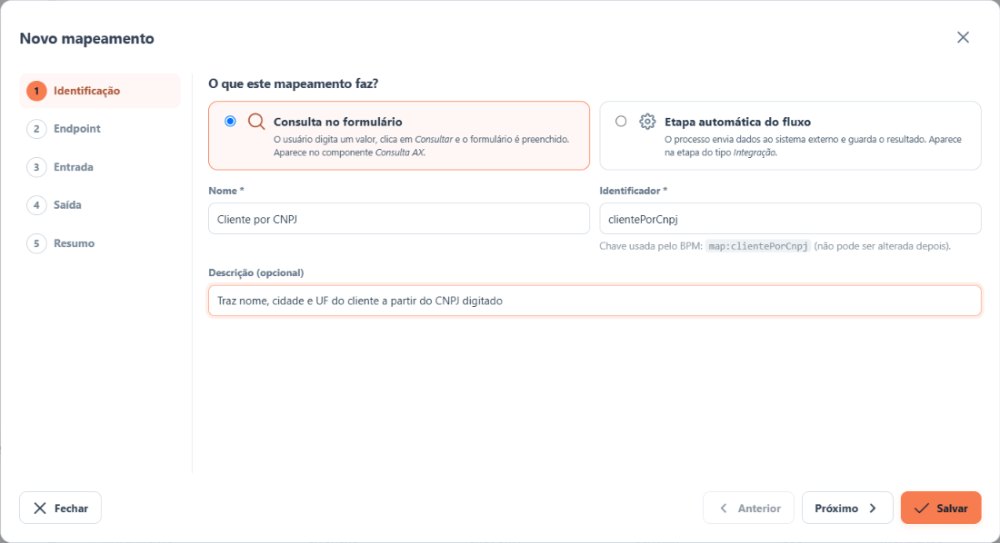

1. Escolha **o que o mapeamento faz**:
   - **Consulta no formulário** — o usuário digita um valor, clica em **Consultar** e o formulário é
     preenchido. A consulta aparece no componente *Consulta AX* do editor de formulários;
   - **Etapa automática do fluxo** — o processo envia dados ao sistema externo e guarda o resultado. A
     etapa aparece na etapa do tipo *Integração* do editor de fluxos.
2. **Nome** — como o mapeamento vai aparecer para quem monta formulários e fluxos (ex.: "Cliente por
   CNPJ").
3. **Identificador** — preenchido automaticamente a partir do nome (ex.: `clientePorCnpj`). Pode ser
   ajustado: comece com uma letra e use só letras, números ou `_`. **Não pode ser alterado depois.**
4. **Descrição** (opcional) — para que serve e quem usa.

O tipo também não pode ser trocado depois de salvar.

### Etapa 2 — Endpoint

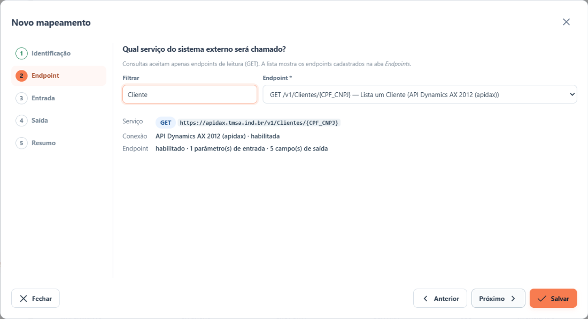

1. Digite parte do nome ou do caminho em **Filtrar** para encontrar o serviço.
2. Escolha o **Endpoint**. Consultas no formulário só aceitam serviços de **leitura**; a etapa automática
   aceita leitura ou gravação.
3. Confira o quadro abaixo: endereço do serviço, conexão e quantas informações ele recebe e devolve.

Avisos que podem aparecer:

- **Endpoint ou conexão desligado** — o mapeamento pode ser salvo, mas vai falhar até você ligá-los.
- **A conexão não está liberada para escritas** — para serviços que gravam: libere as escritas na
  conexão, com o número da aprovação.
- **O endpoint ainda não tem campos de saída** — configure-os na aba *Endpoints* ou digite os caminhos
  na etapa *Saída*.

### Etapa 3 — Entrada

Diga de onde vem cada informação que o serviço precisa receber.

**Na consulta no formulário**, escolha qual parâmetro recebe o **Valor digitado no formulário**:

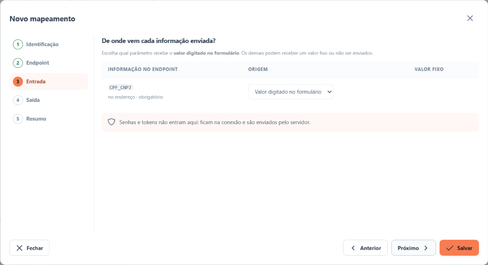

**Na etapa automática**, escolha **Dado do processo** e digite a **chave** de um campo preenchido numa
etapa anterior do fluxo (a chave aparece na aba *API* da configuração do campo, no editor de
formulários):

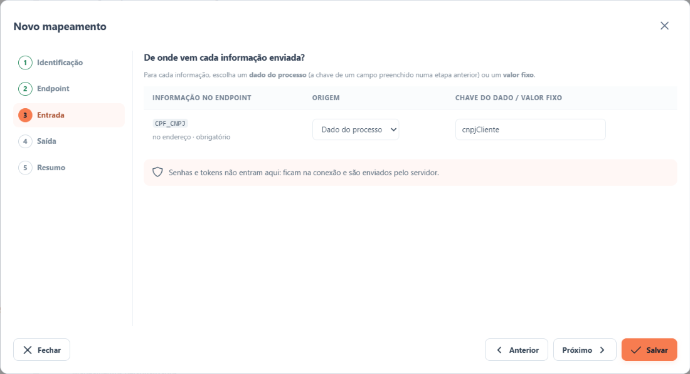

Em qualquer tipo, você também pode usar **Valor fixo** (um texto que é sempre enviado, que não seja
senha) ou **— não enviar —**. Parâmetros marcados como **obrigatório** precisam receber um valor. Para
serviços que gravam, o campo **campo do corpo não documentado** + **Adicionar** inclui uma informação que
o catálogo não mostra.

### Etapa 4 — Saída

Escolha quais informações da resposta voltam para o BPM.

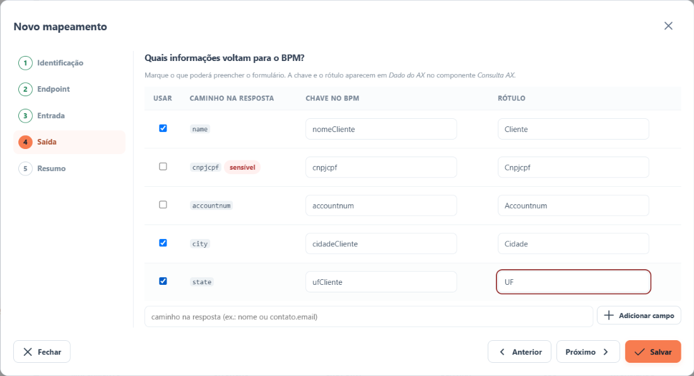

1. Marque **Usar** em cada informação desejada.
2. Ajuste a **Chave no BPM** (comece com letra; use letras, números ou `_`) e o **Rótulo** (como a
   informação aparece para as pessoas).
3. Se o serviço não tiver campos de saída cadastrados, digite o caminho da informação na resposta (ex.:
   `nome` ou `contato.email`) e clique em **Adicionar campo**.

O que acontece com essas informações:

- **Consulta no formulário:** elas aparecem em *Dado do AX*, no componente *Consulta AX*, para preencher
  campos do formulário.
- **Etapa automática:** elas são gravadas nos dados do processo com a chave escolhida. Para mostrá-las
  numa etapa seguinte, crie no formulário dessa etapa um campo **somente leitura com a mesma chave**.

Informações marcadas como **sensível** (CPF, e-mail, telefone…) aparecem mascaradas no histórico.

### Etapa 5 — Resumo e ativação

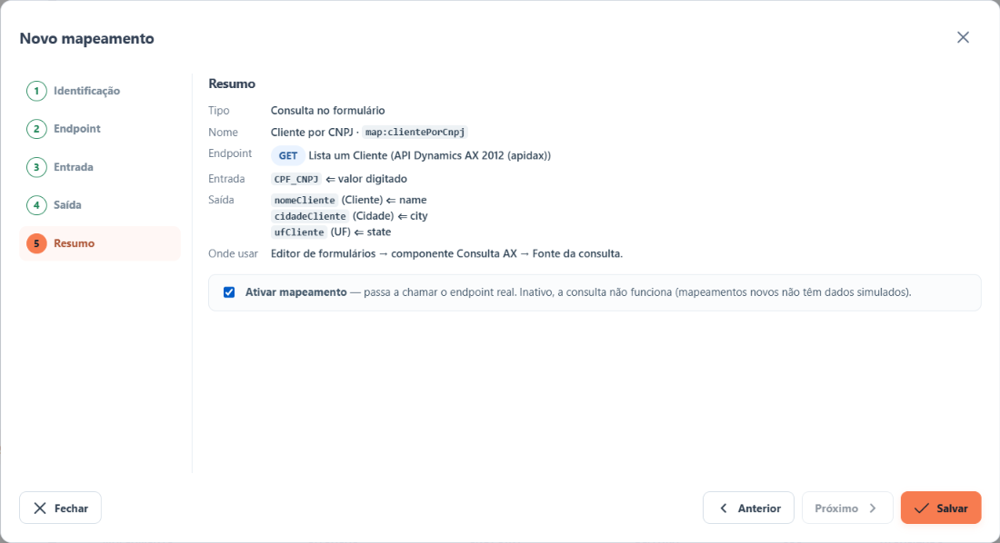

Confira o resumo. Marque **Ativar mapeamento** para que ele passe a chamar o serviço real e clique em
**Salvar**.

- Ativo: "Mapeamento salvo e ativo: já pode ser usado."
- Inativo: "Mapeamento salvo, ainda inativo: ative-o quando estiver pronto." Enquanto inativo, a
  consulta mostra "A consulta … não está ativa no momento" e a etapa automática falha.

Para ativar, o BPM exige pelo menos uma informação de saída e que os parâmetros obrigatórios recebam um
valor (na consulta, que algum parâmetro receba o valor digitado).

### Depois de salvar

O mapeamento aparece em **Mapeamentos personalizados**:

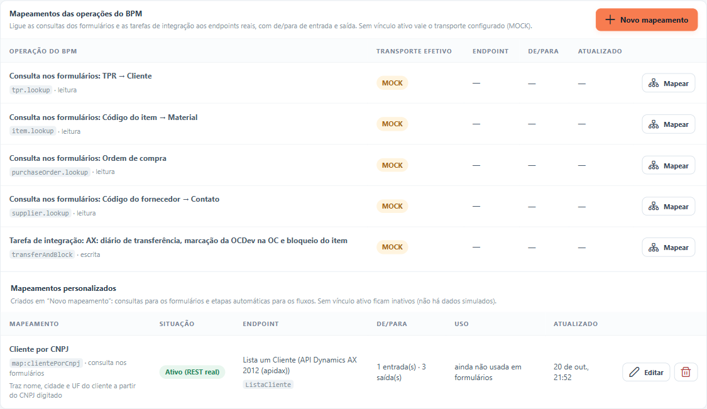

| Coluna | O que mostra |
|---|---|
| **Mapeamento** | Nome, chave usada pelo BPM (`map:…`), tipo e descrição. |
| **Situação** | **Ativo (REST real)**; **Ativo — endpoint/conexão desligado** (vai falhar até ligar); ou **Inativo**. |
| **Uso** | Em quantos formulários (consulta) ou etapas de fluxo (etapa automática) ele é usado. |

- **Editar** abre o mesmo assistente para mudar nome, descrição, endpoint, entrada, saída ou a ativação.
  Mudar a chave de uma saída já usada em formulários faz esses formulários deixarem de recebê-la.
- **Excluir** (lixeira) só fica disponível quando o mapeamento **não está em uso**. Antes, retire-o dos
  formulários ou troque a integração das etapas que o usam.

### Onde o novo mapeamento aparece

**Consulta no formulário** — no editor de formulários, componente **Consulta AX**, lista **Fonte da
consulta** (o nome aparece com o sistema entre parênteses). Configure como no guia
[Usar consultas nos formulários](guia-consumir-formulario.md).

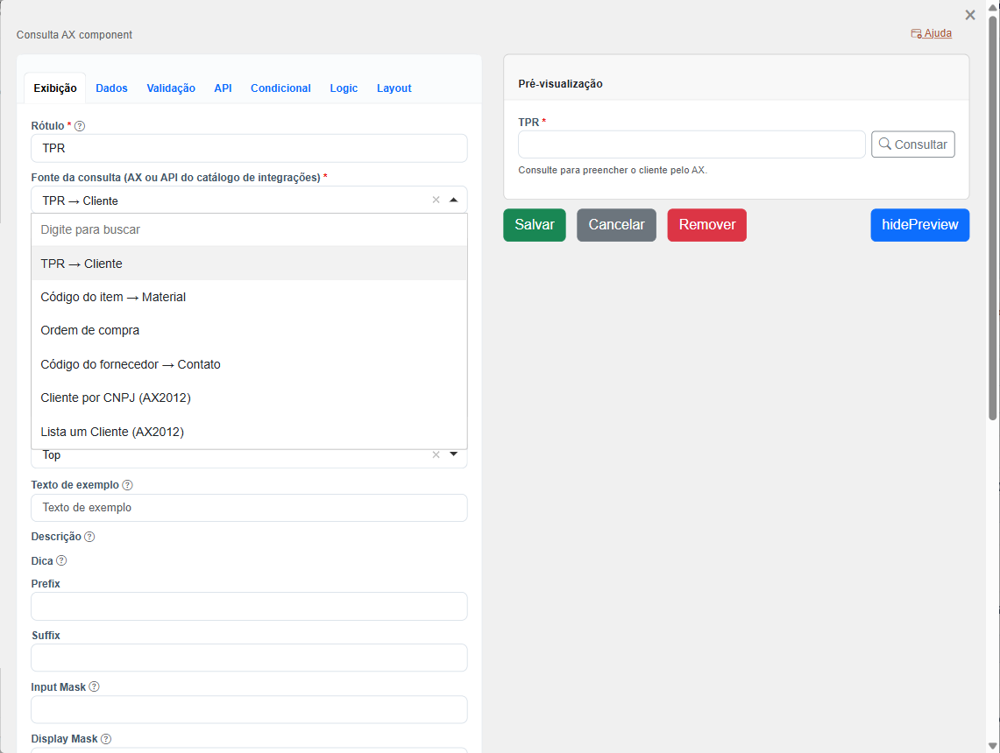

**Etapa automática do fluxo** — no editor de fluxos, etapa do tipo **Integração**, lista **Integração
executada**. Ao escolher, a tela mostra o que a etapa **lê** e **grava** no processo. Veja
[Etapa do tipo Integração](guia-etapa-integracao.md).

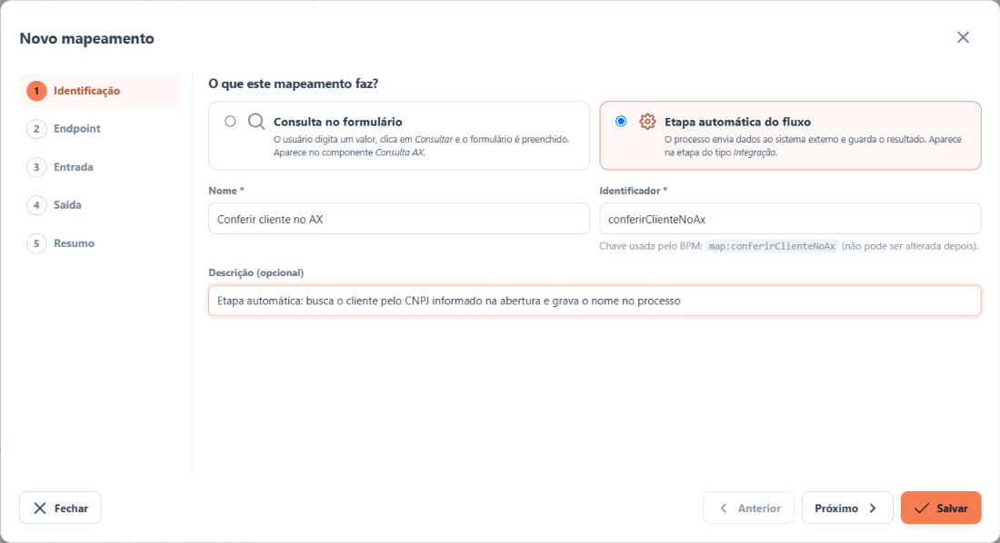

> Quem já estava com o editor aberto precisa **recarregar a página** para ver o mapeamento novo.

## Regras importantes

- **O mapeamento vale para todos os processos e formulários** que usam aquela operação, de uma vez.
- **Operação pronta: voltar ao modo simulado** é simples: abra **Mapear**, desmarque **Ativar vínculo** e
  salve. A mudança vale na hora.
- **Mapeamento novo inativo não funciona**: não há dados simulados para ele. A *Visão geral* avisa
  quando há mapeamentos personalizados inativos, e a validação do fluxo avisa quando uma etapa usa um.
- **Serviço ou conexão desligado com o vínculo ativo faz a operação falhar** (pílula vermelha). Ligue os
  dois ou desative o vínculo.
- Nas consultas, "não encontrado" no sistema externo aparece para o usuário como "não foi encontrado",
  sem erro.
- Nas gravações, se uma tentativa demorar demais e ficar a dúvida se gravou, o BPM **não repete** até
  alguém conferir. Veja [Acompanhar e resolver problemas](guia-operacao-e-suporte.md).
- Trocar o serviço de uma gravação enquanto há tentativas pendentes pode fazer o BPM enviar de novo.
  Evite trocar no meio de um processo.

## Exemplos para as operações prontas

Os exemplos abaixo são **ilustrativos**. Os nomes dos campos da resposta precisam vir do **seu** serviço
(da etapa *Parâmetros de saída*), não destes exemplos.

### Consulta: código do fornecedor → contato

Serviço "Lista um Fornecedor", que recebe o CPF ou CNPJ.

| Destino no endpoint | Origem |
|---|---|
| CPF_CNPJ | Valor digitado no formulário |

| Campo do BPM | Caminho na resposta (exemplo) |
|---|---|
| Fornecedor | `nome` |
| Contato | `contato.nome` |
| Telefone | `contato.telefone` |
| E-mail | `contato.email` |

### Gravação: diário de transferência no AX

Serviço "Criar Ordem De Transferencia". A conexão precisa estar com as escritas liberadas.

| Destino no endpoint | Origem |
|---|---|
| transferId | dado do processo: número da OCDev |
| lines[].itemId | dado do processo: código do item |
| lines[].transferQty | valor constante `1` |
| lines[].lineNum | valor constante `1` |

| Campo do BPM | Caminho na resposta (exemplo) |
|---|---|
| Nº do diário de transferência | `transferId` |
| OCDev marcada na OC | `ocMarcada` |
| Item bloqueado | `bloqueado` |

> **Pendente:** ainda falta confirmar com a equipe do AX qual serviço faz, de fato, "diário de
> transferência + marcação da OCDev na OC + bloqueio do item". Até lá, essa operação continua em modo
> simulado.

## Leia também

- [Usar consultas nos formulários](guia-consumir-formulario.md)
- [Etapa do tipo Integração](guia-etapa-integracao.md)
- [Acompanhar e resolver problemas](guia-operacao-e-suporte.md)
