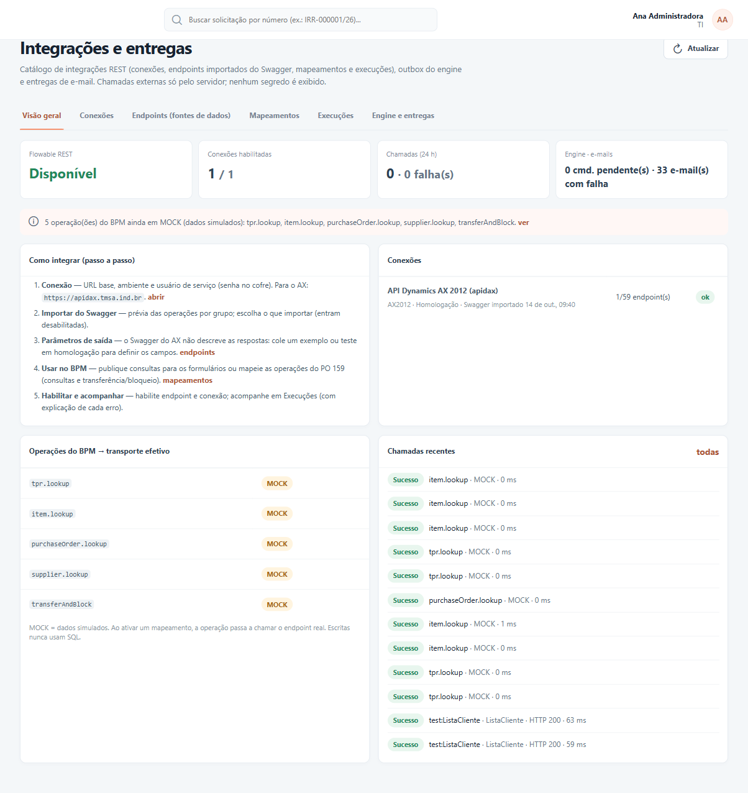
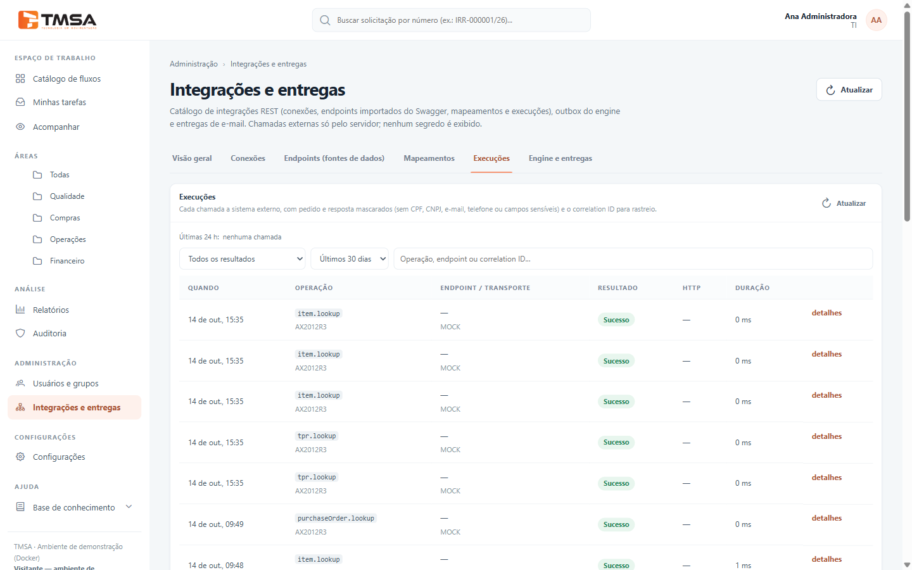
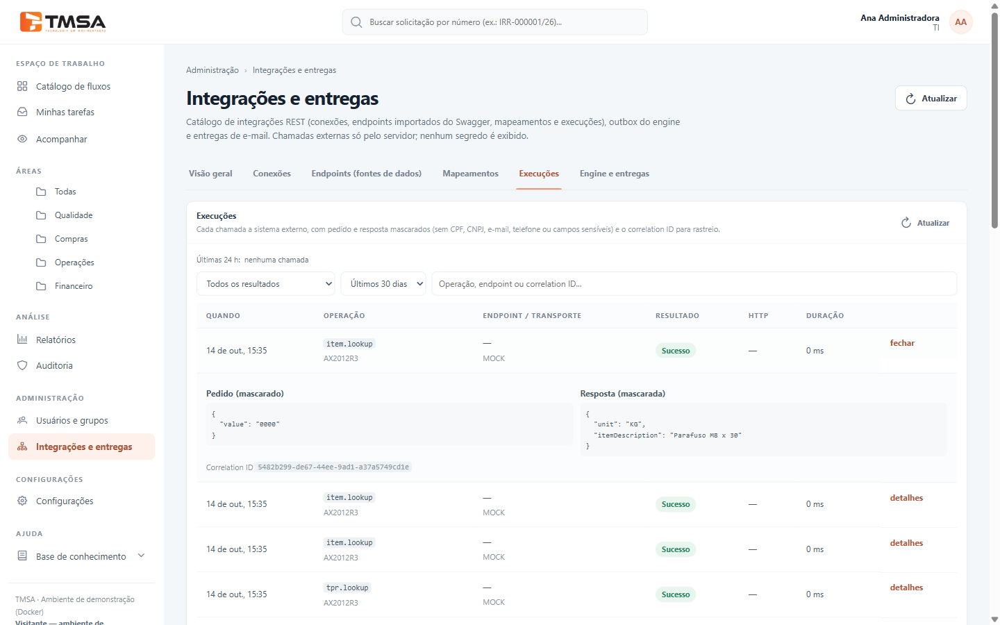

# Acompanhar e resolver problemas

Este guia é para quem acompanha o dia a dia das integrações: ver se está tudo funcionando, entender por
que uma chamada falhou e resolver os casos que precisam de uma decisão humana.

Configuração: [Criar uma integração](guia-criar-integracao.md) e
[Mapeamentos e modo simulado](guia-mapeamentos-e-mock.md).

## Visão geral: está tudo funcionando?

Abra **Administração → Integrações e entregas**, aba **Visão geral**.

No topo:

| Indicador | O que mostra |
|---|---|
| **Flowable REST** | Se o motor que executa os processos está **Disponível**. |
| **Conexões habilitadas** | Quantas conexões estão ligadas, do total cadastrado. |
| **Chamadas (24 h)** | Quantas chamadas a sistemas externos houve no último dia e quantas falharam. |
| **Engine · e-mails** | Comandos aguardando o motor de processos e e-mails que não puderam ser enviados. |

Logo abaixo aparecem **alertas** automáticos, com um link para resolver:

- "Conexão …: o último teste falhou." — teste de novo a conexão e veja o motivo;
- "Conexão …: N endpoint(s) com contrato alterado no Swagger" — o sistema externo mudou: importe de
  novo e revise;
- "N chamada(s) com falha nas últimas 24 h." — veja em *Execuções*;
- "Há escrita(s) com resultado incerto aguardando reconciliação." — alguém precisa decidir (veja abaixo);
- "N operação(ões) do BPM ainda em MOCK (dados simulados)" — essas operações ainda usam dados fictícios;
- "N mapeamento(s) personalizado(s) inativo(s)" — mapeamentos criados em *Novo mapeamento* que estão
  desligados: os formulários e etapas que os usam vão falhar até ativá-los.

No quadro **Operações do BPM → transporte efetivo**, os mapeamentos personalizados aparecem com o nome
embaixo da chave (`map:…`) e a pílula **INATIVO** (vermelha) quando estão desligados.

Os quadros mostram o passo a passo de configuração, as conexões, como cada operação do BPM está
funcionando (simulada ou real) e as chamadas mais recentes.

> A *Visão geral* mostra dados apenas para administradores e auditores.

## Execuções: o histórico de cada chamada

A aba **Execuções** lista cada chamada feita a um sistema externo. Dados pessoais (CPF, CNPJ, e-mail,
telefone e campos sensíveis) aparecem mascarados.

- **Filtros:** por resultado ("Somente falhas", "Sucesso", "Não encontrado", "Resultado incerto
  (reconciliar)"), por período e por texto (operação, serviço ou código de rastreio).
- **Resultado:** **Sucesso**, **Não encontrado**, **Resultado incerto** ou **Reconciliado (repetir)**.
- **detalhes:** mostra o que foi enviado e recebido (mascarado), a explicação do erro com **O que
  fazer:**, o **Correlation ID** (código de rastreio) e a solicitação ligada à chamada.

> Ao pedir ajuda à equipe técnica ou à equipe do sistema externo, informe sempre o **Correlation ID**:
> com ele é possível achar a chamada exata nos registros.

## Reconciliar uma gravação com resultado incerto

Quando uma gravação demora demais **depois** de enviada, o BPM não sabe se o sistema externo gravou.
Para não gravar em dobro, ele marca a chamada como **Resultado incerto** e bloqueia novas tentativas até
alguém decidir.

Quem pode: usuários com permissão de **gestão de processos**.

1. Em *Execuções*, filtre por **Resultado incerto (reconciliar)**.
2. **Confira no sistema externo** se a gravação aconteceu (ex.: se o diário de transferência existe no
   AX).
3. Clique em **Reconciliar** e escolha:
   - **Foi executada** — informe o resultado em **Saídas**, um por linha, no formato `campo=valor` (ex.:
     `numeroDiarioTransferencia=OT-000124`). A próxima tentativa usa esse resultado **sem enviar de
     novo**;
   - **Não foi executada** — a próxima tentativa envia de novo.
4. Se quiser, escreva uma **Observação** (até 300 caracteres) e clique em **Confirmar**.

Faça isso o quanto antes: a etapa automática tenta de novo a cada 5 minutos e, esgotadas as tentativas,
a solicitação fica parada (veja [Etapa do tipo Integração](guia-etapa-integracao.md)).

## Problemas comuns e o que fazer

A explicação de cada erro aparece nos detalhes da execução. Os mais comuns:

| O que aparece | Causa provável | O que fazer |
|---|---|---|
| **Destino bloqueado pela política de rede** | O endereço do sistema não foi liberado no servidor do BPM. | Peça à equipe de TI para liberar o endereço. |
| **Credencial recusada pela API** | Senha, token ou chave inválidos ou vencidos. | Na conexão, informe a nova senha e teste de novo. |
| **Acesso negado pela API** | O usuário de serviço não tem permissão naquele serviço. | Peça à equipe do sistema externo para liberar o acesso. |
| **Credencial não verificada** | A conexão não tem caminho de verificação. | Preencha o **Caminho de verificação** e teste a conexão. |
| **Token não encontrado na resposta** | O login funcionou, mas o BPM não achou o código de acesso na resposta. | Preencha **Caminho do token na resposta** na conexão. |
| **Requisição recusada pela API** | O sistema não aceitou os dados enviados. | Confira o mapeamento (entrada) e os campos obrigatórios. |
| **Requisição incompleta** | Faltou uma informação obrigatória. | Garanta que o formulário ou o processo preencha o dado, ou ajuste o mapeamento. |
| **Escrita não liberada** | A conexão não está liberada para gravar. | Libere as escritas na conexão, com o número da aprovação. |
| **Reconciliação pendente** | Uma tentativa anterior ficou com resultado incerto. | Reconcilie em *Execuções* (veja acima). |
| **Tempo esgotado** | O sistema demorou demais para responder. | Tente de novo; se persistir, acione a equipe de TI. Em gravações, o resultado fica incerto. |
| **Não foi possível conectar** | O servidor do BPM não alcança o sistema. | Acione a equipe de TI. |
| **Limite de envio/requisições** | O sistema externo limitou o número de chamadas. | Aguarde alguns minutos. |
| **Erro do provedor** / indisponível | Erro dentro do sistema externo. | Acione a equipe do sistema externo com o Correlation ID. |
| **Resposta grande demais** | O serviço devolveu dados demais. | Use um serviço mais específico ou acione a equipe de TI. |
| Pílula vermelha **REST — endpoint/conexão desligado** | O mapeamento está ativo, mas o serviço ou a conexão está desligado. | Ligue os dois, ou desative o mapeamento para voltar ao modo simulado. |
| "A consulta … não está ativa no momento" (formulário) ou etapa com "mapeamento inativo" | Um mapeamento criado em *Novo mapeamento* está inativo (ele não tem modo simulado). | Ative-o na aba *Mapeamentos* (**Editar** → *Resumo* → **Ativar mapeamento**). |

## Auditoria

Toda mudança de configuração e toda execução ficam registradas em **Auditoria**, sem senhas e sem os
valores dos formulários. Eventos que você pode procurar:

- Integração concluída / Integração falhou;
- Conexão de integração salva / testada;
- Credencial de integração substituída;
- Endpoints importados do OpenAPI/Swagger / Contrato do endpoint atualizado pela importação;
- Endpoint de integração salvo / removido / testado;
- Vínculo de operação com endpoint salvo;
- Mapeamento personalizado criado / excluído;
- Escrita com resultado incerto reconciliada.

## Pontos de atenção

1. **Modo simulado em processos reais.** Sem mapeamento ativo, a operação usa dados fictícios, inclusive
   em produção. Desativar um mapeamento por engano faz processos reais gravarem números fictícios (DT-…).
2. **Consulta desligada depois de usada.** Se uma consulta for desligada ou despublicada, os formulários
   que a usam param de preenchê-la. Importar de novo o Swagger pode mudar os campos devolvidos.
3. **Qualquer usuário** com acesso ao BPM pode usar qualquer consulta publicada.
4. **Etapa automática parada.** Depois de esgotar as tentativas, a solicitação fica parada na etapa de
   integração e precisa do suporte técnico para seguir.
5. **"Não encontrado" numa gravação conta como sucesso**, sem resultado. Se isso não fizer sentido para
   a operação, revise o serviço escolhido.
6. **Ativar um mapeamento não confere** se o serviço e a conexão estão ligados. Confira a pílula verde
   **REST (real)** depois de salvar.
7. **As mensagens dos formulários dizem "AX"** mesmo quando o sistema é outro.
