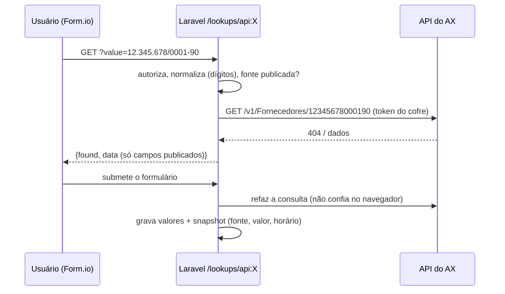

# Consumo dos endpoints do catálogo (fontes de dados) no Form.io — análise e recomendação

Análise feita sobre `http://localhost:8080/flows/homologacao_fornecedor/edit` (versão 2, rascunho) e o
código atual do construtor (`apps/web/src/components/forms/formio.ts`), do saneador
(`FormioSchemaSanitizer`), do processamento de submissões (`SubmissionProcessor`) e do worker de
integrações (`ExternalJobWorker`). Catálogo: `docs/integracoes/README.md` / ADR-0016.

## 1. Restrições que definem a solução

| Regra do projeto | Consequência para o Form.io |
|---|---|
| Laravel é a única API pública; o navegador nunca fala com o AX | Nada de `select` com `dataSrc: url`, `fetch` no formulário ou "submit para URL externa". Todo GET passa por um endpoint do BPM que só executa **fontes publicadas** no catálogo. |
| Form.io só no cliente, sem JavaScript do designer | Nada de `calculateValue`, `customDefaultValue`, lógica JS para transformar dados. Transformações são **declarativas** e executadas no servidor. |
| Validação no servidor | Todo valor vindo da API é **revalidado/refeito na submissão** (o navegador não é fonte de verdade). |
| Sem transação distribuída / outbox | Escrita no AX **nunca** acontece na requisição do usuário: a submissão grava no BPM e uma **etapa de integração** (worker) faz o POST depois, com idempotência e reconciliação. |
| Sem PII/token em logs; segredos só no cofre | Respostas guardadas como estrutura/snapshot mínimo; credencial só na conexão. |

## 2. O fluxo hoje

```
Início → [SUP] Solicitar homologação → [QUALIDADE] Avaliar documentação → ◇ Aprovado? → Homologado | Não homologado
```

| Formulário | Campos |
|---|---|
| `f_solicitar` — Cadastro inicial do fornecedor | `razaoSocial`*, `cnpj`*, `categoriaFornecimento`* (lista fixa mp/componente/servico), `documentosFornecedor` (anexos) |
| `f_avaliar` — Avaliação documental | painel com `razaoSocial`/`cnpj` (cópia), `aprovado`* (sim/não), `parecer`* |

Nada é consultado nem gravado no AX: o fornecedor "homologado" continua precisando ser cadastrado à mão.

### Capacidades e lacunas atuais

| Capacidade | Situação |
|---|---|
| Consulta com preenchimento (`axlookup`) usando `api:<identificador>` | ✅ existe (servidor refaz a consulta ao salvar e grava snapshot em `meta.lookups`) |
| "Não encontrado" como resultado válido | ❌ sempre vira erro de validação — na homologação, *não existir no AX* é o caso esperado |
| Escolher os campos de destino do preenchimento | ⚠ digita-se a chave do campo; a lista "Dado do AX" mistura campos de todas as fontes |
| Lista de opções vinda da API (grupo, condição de pagamento, moeda, site...) | ❌ saneador força `dataSrc: values` e a submissão só aceita valores declarados |
| Tabela (datagrid) preenchida pela API (ex.: linhas da OC) | ❌ |
| Consulta automática no fluxo (sem ação do usuário) | ❌ etapa de integração só tem operações fixas |
| POST de um endpoint do catálogo a partir do fluxo | ❌ etapa de integração só oferece `ax.transferAndBlock`; vínculos são globais e fixos |
| Transformação de dados para o payload (CNPJ só dígitos, datas, números pt-BR, sim/não → 1/0, listas) | ❌ |

## 3. GET — como buscar dados no formulário (recomendado)

Quatro padrões, todos com **proxy no Laravel + revalidação na submissão**:

| Padrão | Quando usar | Componente | Exemplo no AX |
|---|---|---|---|
| **A. Consulta com preenchimento** | o usuário informa uma chave e o formulário traz dados relacionados | `axlookup` (já existe) + melhorias abaixo | CNPJ → fornecedor (`GET /v1/Fornecedores/{CPF_CNPJ}`), CEP → endereço (`GET /v1/Geral/Endereco/{cep}`), OC → fornecedor |
| **B. Lista de opções da API** | escolher um código válido do AX | **novo** `apiselect` (grupo TMSA) | grupo de fornecedores, grupo de impostos, condição/método de pagamento, moeda, site |
| **C. Tabela preenchida pela API** | trazer várias linhas para conferir/editar | `axlookup` em modo lista → `datagrid` | OC → linhas (`/v1/Compras/OrdemdeCompraLinhas/{oc}`) |
| **D. Consulta automática na etapa** | dado de apoio sem ação do usuário (ex.: antes de uma avaliação) | etapa **Integração (API)** de leitura | após "Solicitar", conferir se o CNPJ já existe e mostrar ao avaliador |

### A. Consulta com preenchimento — melhorias

1. **Comportamento para "não encontrado"**: `erro` (padrão atual) · `permitir` · `alertar`, com campo opcional
   `existeNoSistema` (sim/não) preenchido pelo servidor — utilizável nas condições do gateway (DSL).
2. **Destinos por lista**: escolher o campo de destino entre os campos do formulário e a origem somente
   entre os campos **da fonte selecionada** (o editor do componente é código nosso, não do designer).
3. **Normalização da chave antes da consulta** (declarativa, na fonte publicada): `somente dígitos`
   (CNPJ/CPF/CEP), `maiúsculas`, `aparar`. Evita "não encontrado" por máscara.
4. Campos de destino ficam **somente leitura** por padrão (o servidor já sobrescreve na submissão).



### B. Lista de opções da API (`apiselect`) — o padrão que falta

- No catálogo, o endpoint ganha **"Usar como lista de opções"**: caminho do **valor** (código AX,
  ex.: `vendGroupId`) e do **rótulo** (ex.: `name`), parâmetro de **busca** opcional (para listas
  grandes), constantes (ex.: `{filter}`), **tempo de cache** (ex.: 10 min).
- Proxy `GET /api/v1/options/api:<id>?q=` → `[{value, label}]` (máx. 50; busca no servidor a partir de
  2 caracteres em listas grandes). O token nunca sai do servidor.
- **Submissão**: o servidor confere que o valor escolhido está na lista (cache/nova consulta) e grava
  **`{value, label}`** — etapas seguintes, relatórios e notificações mostram o rótulo mesmo se o AX mudar.
- Saneador: aceita `apiselect` só com fonte publicada como lista; continua recusando `dataSrc: url`.

### C/D. Tabela e consulta automática

- **C**: modo lista do `axlookup` com mapeamento por coluna (`linhas[].itemId → coluna item`), limite de
  linhas e revalidação; útil no PO 159 (OC → linhas).
- **D**: etapa "Integração (API)" de **leitura** que grava saídas no processo; o formulário seguinte as
  exibe como cópia somente leitura.

## 4. POST — como tratar os dados e enviar

### Por que não enviar pelo formulário

Enviar direto do navegador exporia credencial, pularia a validação do servidor e misturaria a gravação
no AX com a requisição do usuário (sem outbox, sem reconciliação). O Form.io também não tem "ação de
envio" no modo client-side adotado.

### Fluxo recomendado

```
Formulário → Laravel (SubmissionProcessor valida) → dados do processo
→ ◇ condição (ex.: aprovado = sim) → [Integração (API)] etapa automática (worker)
   1. monta o payload pelo MAPEAMENTO da etapa (campos do processo/constantes + transformações)
   2. valida contra o corpo do Swagger (obrigatórios/tipos) — sem chamar o AX se faltar dado
   3. pré-verificação idempotente (opcional): GET de existência; se já existe, usa o resultado e não posta
   4. POST pelo catálogo (escrita liberada na conexão, chave = instância+etapa)
   5. grava saídas no processo (ex.: contaFornecedorAx) → visíveis nas etapas seguintes
   6. falha transitória: novas tentativas; resultado incerto: reconciliação; falha final: caminho de erro
```

Hoje a etapa de integração aceita só `ax.transferAndBlock` (operação fixa). Recomendação: **etapa
"Integração (API)" genérica**, configurada no editor do fluxo: endpoint do catálogo (leitura ou escrita),
mapeamento de entrada, mapeamento de saída, pré-verificação e política de erro. Os **vínculos globais**
(Mapeamentos) continuam para as operações fixas do PO 159; fluxos novos usam o mapeamento **por etapa**
(cada fluxo pode montar o mesmo endpoint de forma diferente).

### Tratamento dos dados (transformações declarativas)

| Transformação | Uso típico no AX | Exemplo |
|---|---|---|
| `digits` | `cnpjcpfNum`, CEP | `12.345.678/0001-90` → `12345678000190` |
| `trim`, `upper`, `truncate:n` | nomes/descrições com tamanho máximo | `Indústria Exemplo Ltda` → `INDÚSTRIA EXEMPLO LTDA` |
| `number` (pt-BR) | quantidades/preços | `1.234,56` → `1234.56` |
| `int` | campos `int32` | `"5"` → `5` |
| `date` / `datetime` | `shipDate`, datas | `14/10/2026` → `2026-10-14` / `2026-10-14T00:00:00` |
| `bool01` | `blocked`, `isPrimary` | `sim` → `1` |
| `map` | código do BPM → código do AX | `servico` → `SERV` |
| `const` | `dataAreaId`, `currency` padrão | `tmsa`, `BRL` |
| `list` (datagrid → array) | `contacts[]`, `lines[]` com `lineNum` automático | linha 1 → `{lineNum: 1, itemId: ...}` |
| `label` / `value` de `apiselect` | enviar o código; mostrar o rótulo | `{value: "NAC", label: "Nacionais"}` → `"NAC"` |
| `omitEmpty` | não enviar campos vazios (vs. `null`) | — |

Junto com isso, a configuração da etapa deve ter **pré-visualização do payload** (com dados de uma
instância de exemplo, sem chamar o AX), validação contra os campos obrigatórios do Swagger e alerta de
campos sensíveis (CPF de pessoa física, dados bancários) — mascarados no log.

## 5. Aplicação ao `homologacao_fornecedor`

### Formulário "Solicitar homologação" (proposto)

| Campo | Componente | Fonte (catálogo) | Observação |
|---|---|---|---|
| `cnpj`* | Consulta (padrão A), chave só dígitos, **não encontrado = permitir** | `GET /v1/Fornecedores/{CPF_CNPJ}` (`ListaFornCNPJ`) | preenche `existeNoAx` (sim/não) e `contaFornecedorAx`; se já existir → alerta e o fluxo pode encerrar em "Já cadastrado" (condição DSL) |
| `razaoSocial`* | texto | — | maiúsculas/limite no payload |
| `cep` | Consulta (A) | `GET /v1/Geral/Endereco/{cep}` (`GetEnderecoAsync`) | preenche logradouro, bairro, cidade, UF (somente leitura) |
| `numero`, `complemento` | texto | — | |
| `grupoFornecedor`* | Lista da API (B) | `GET /v1/Fornecedores/Grupos/{filter}` | valor = código do grupo |
| `grupoImpostos`* | Lista da API (B) | `GET /v1/Financeiro/GrupoDeImpostos/{filter}` | |
| `condicaoPagamento` / `metodoPagamento` | Lista da API (B) | `.../CondicoesDePagamento/{filter}`, `.../MetodosDePagamento/{filter}` | |
| `moeda` | Lista da API (B), padrão BRL | `GET /v1/Financeiro/Moeda` | |
| `site` | Lista da API (B) | `GET /v1/EstabelecimentoFiscal/Sites` | |
| `contatos` | datagrid (tipo, descrição, valor, principal) | — | vira `contacts[]` |
| `categoriaFornecimento`* | lista fixa (como hoje) ou `map` → código AX | — | |
| `documentosFornecedor` | anexos (como hoje) | — | não vão ao AX |

### Fluxo proposto

```
Início → Solicitar → [Integração (API) leitura] Conferir CNPJ no AX (opcional, padrão D)
→ ◇ Já existe no AX? ── sim → Encerrar "Já cadastrado (conta X)"
                     └─ não → Avaliar documentação → ◇ Aprovado?
                                  ├─ não → Não homologado
                                  └─ sim → [Integração (API) escrita] Cadastrar fornecedor no AX
                                              → Homologado (notifica SUP com a conta criada)
                                              ↘ falha final → [SUP] Tratar falha de integração
```

### Mapeamento da escrita → `POST /v1/Fornecedores/CriarFornecedorCompleto` (`VendorModel`)

| Corpo (`VendorModel`) | Origem | Transformação |
|---|---|---|
| `name` | `razaoSocial` | `trim`, `upper`, `truncate` (confirmar tamanho) |
| `cnpjcpfNum` | `cnpj` | `digits` (marcar sensível se CPF) |
| `vendGroupId` | `grupoFornecedor` | `value` |
| `taxGroup` | `grupoImpostos` | `value` |
| `paymTerm` / `paymMode` | `condicaoPagamento` / `metodoPagamento` | `value` |
| `currency` | `moeda` | `value`, padrão `const:BRL` |
| `siteId` | `site` | `value` |
| `zipCode`, `street`, `streetNumber`, `buildingCompliment`, `districtName`, `city`, `state` | campos de endereço | `digits` no CEP |
| `contacts[]` (`type`, `description`, `locator`, `isPrimary`) | `contatos` (datagrid) | `list`, `map` (tipo → código AX), `bool01` |
| `blocked` | constante | `const:0` (ou bloqueado até liberação fiscal — decidir) |
| `countryRegionId` | constante | `const:BRA` (confirmar) |
| dados bancários (`bank*`) | **fora do escopo inicial** | se entrarem: sensíveis, mascarados |

- **Pré-verificação**: `GET /v1/Fornecedores/{CPF_CNPJ}`; se existir, usa a conta encontrada e não posta
  (resolve repetição e reconciliação sem intervenção).
- **Saída**: `contaFornecedorAx` ⇐ caminho na resposta do POST — **a resposta não está documentada**:
  definir com um teste em homologação ou com o time da API.
- **Pré-requisitos**: conexão `apidax` com escrita liberada (aprovação), usuário de serviço e ambiente de
  homologação da API.

## 6. O que evitar

- `select` com `dataSrc: url`/`data.url`, cabeçalhos ou token no esquema do formulário (o saneador já recusa).
- `calculateValue`/lógica JS para formatar CNPJ, datas ou montar payload.
- POST no envio do formulário ou em botão do formulário.
- Guardar a resposta inteira da API na submissão (só campos publicados + snapshot mínimo).
- Confiar em valores preenchidos pelo navegador (lookup e lista são refeitos/validados no servidor).
- Usar `/Access` (senha na URL) ou reaproveitar o token do SoftExpert.

## 7. Plano de implementação sugerido

| Fase | Entrega | Testes |
|---|---|---|
| **1 — Leituras no formulário** | `axlookup`: "não encontrado" configurável + `existeNoSistema`, destinos por lista, normalização da chave; **`apiselect`** com proxy `/options`, cache, validação na submissão e snapshot `{value,label}`; endpoint "usar como lista" no catálogo | saneador (fonte não publicada recusada), valor fora da lista recusado, snapshot gravado, token nunca no navegador |
| **2 — Escrita por etapa** | etapa **Integração (API)** genérica no editor do fluxo: endpoint, mapeamento entrada/saída com transformações, validação contra o Swagger, **pré-visualização do payload**, pré-verificação idempotente, caminho de erro | montagem do payload (cada transformação), obrigatórios faltando não chamam o AX, pré-verificação evita POST, saídas no processo, reconciliação |
| **3 — Complementos** | tabela preenchida pela API (padrão C), leitura automática (D), rótulos de `apiselect` em relatórios/notificações | — |

## 8. Pendências para o time da API do AX

1. Significado do parâmetro de caminho obrigatório **`{filter}`** em várias listas (empresa/`dataAreaId`? curinga?).
2. **Formato da resposta** de `CriarFornecedor`/`CriarFornecedorCompleto` (conta gerada?) e das listas (campos de código/descrição).
3. Campos obrigatórios e tamanhos do `VendorModel`; códigos de `contacts[].type`; valor de `countryRegionId`.
4. Idempotência no POST (aceitar `Idempotency-Key` ou garantir rejeição de CNPJ duplicado com código claro).
5. Ambiente de homologação e usuário de serviço do BPM.
